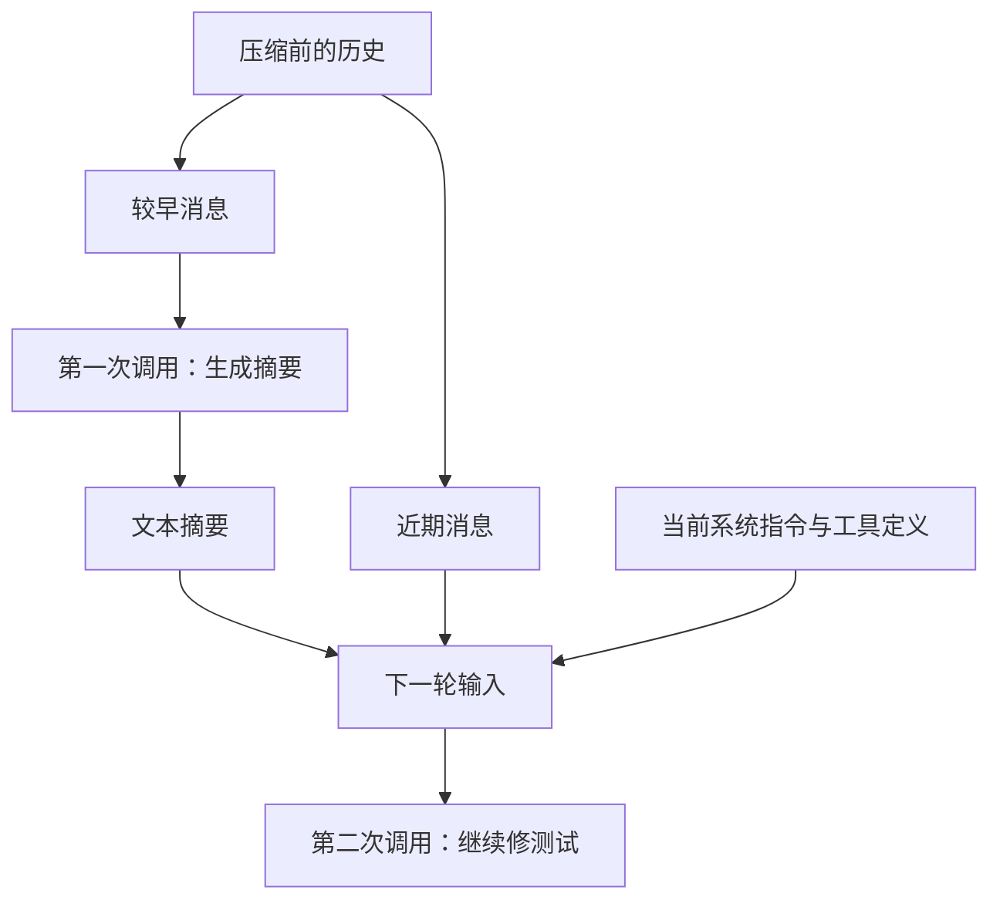
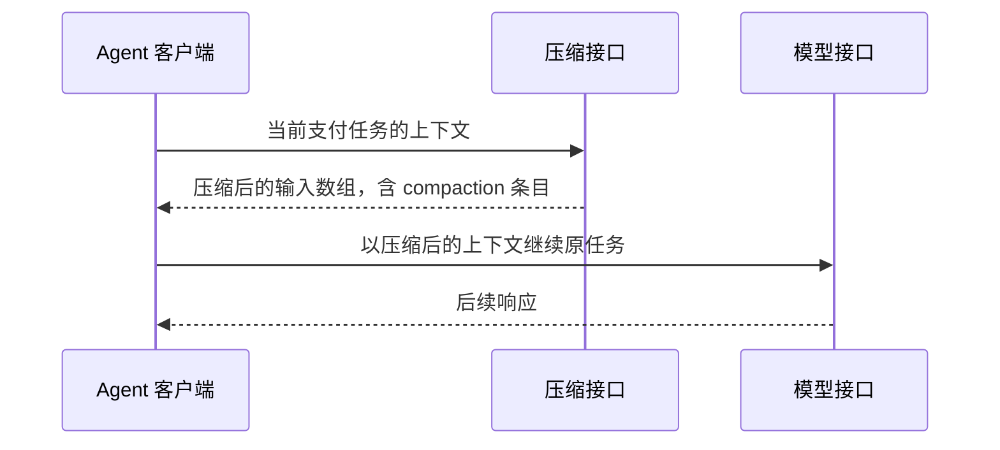

支付代码改到一半，Agent 已经读过源码、查过接口、改过下单逻辑，正在修一个重复回调测试。此时界面提示：正在压缩上下文。

代码还在磁盘上，任务也要继续。压缩要解决的是：**下一次调用模型时，用什么内容承接前面的工作。**

本文用同一个支付任务走两遍：Pi 把较早的消息整理成文本摘要，再接上近期消息；OpenAI Responses 由服务端压缩，返回后续请求可以继续使用的状态。

## 压缩前，一次请求里装了什么

支付改造的任务要求如下：

> 新订单接入微信 H5 支付，历史支付宝订单继续兼容。保留签名校验、金额校验和回调幂等，补齐测试。

接下来每读一次文件、跑一次命令，都会产生新的工具调用和结果。以客户端在请求里显式携带历史的方式为例，执行到修测试时，输入已经长成这样。下面是简化示意：

```text
系统指令与工具定义

较早的消息：
  用户提出支付改造要求
  Agent 调用 read(service.ts) → 工具返回支付服务源码
  Agent 调用 read(provider.ts) → 工具返回上游接口实现
  Agent 调用 edit(service.ts) → 工具返回修改成功
  ……其余读取、修改和验证过程……

近期的消息：
  Agent 调用 test() → 工具返回：重复回调测试失败
  Agent 调用 read(callback.ts) → 工具返回当前回调源码
```

模型需要这些材料，才能判断下一步怎样修测试。随着执行推进，输入会持续增长，逐渐逼近上下文窗口的容量。

这里的“上下文”，指**本次请求交给模型的工作材料**。Pi 会另行保存会话记录，压缩条目决定后续请求如何从这些记录中组装输入。[^pi-session]

因此，理解压缩最直接的办法，就是对照压缩前后的请求。

## 本地压缩：旧消息变成摘要，近期消息继续保留

这里以 Pi 的内置压缩为例。Pi 是本机运行的 Agent 客户端，它负责选消息、请求摘要、重建输入。摘要本身仍然可以由远端模型生成。

“本地”描述的就是这部分控制权：**由客户端决定怎样整理历史。**

### 第一步：选出要摘要的部分

Pi 从最近的消息往前计算 token 预算，划出保留范围。支付任务可以分成两段：

| 部分 | 内容 | 处理方式 |
| --- | --- | --- |
| 较早消息 | 原始要求、源码读取、下单修改过程 | 交给模型生成摘要 |
| 近期消息 | 刚失败的测试、正在看的回调源码 | 原样接到摘要后面 |

这样分的原因很直接：早期的大段源码和探索过程可以提炼成进展；眼前的失败输出和源码还在参与修复，保留原文更方便继续工作。

实际边界还会照顾工具调用与结果的连续关系。若边界落在同一个用户轮次内部，Pi 会为该轮前半段补充摘要，帮助保留部分衔接语境。[^pi-compact]

### 第二步：单独调用模型，给旧消息写摘要

这时会发生一次专门的模型调用，其任务是总结历史。这里的“摘要模型”指这次承担总结工作的模型。输入可以理解为：

```text
摘要指令：
  整理任务目标、约束、已完成工作和待办。

待总结的材料：
  原始支付改造要求
  较早的源码读取结果
  下单逻辑的修改与验证过程
```

Pi 会先把选中的消息转成文本，再发给摘要模型。工具结果也参与摘要，并经过长度限制。[^pi-serialize]

下面是一份为解释流程编写的摘要：

```text
目标：新订单接入微信 H5，历史支付宝订单沿用原通道。
约束：保留签名、金额校验和回调幂等。
进展：下单逻辑已修改，回调测试待验证。
待办：验证回调幂等，再运行类型检查与 lint。
```

这次调用产出的是任务状态。修复代码会在后续工作调用中继续。

### 第三步：把摘要和近期消息一起发给工作模型

Pi 拿到摘要后，重建下一轮输入：

```text
system     当前系统指令
user       历史摘要：目标、约束、下单进展和待办
assistant  调用 test()
tool       重复回调测试失败的原始输出
assistant  调用 read(callback.ts)
tool       当前回调源码
```

工具定义也由运行时照常提供。这里把摘要放在 `user` 消息中，是 Pi 的转换约定；正文会带摘要说明和 `<summary>` 标签。[^pi-messages]

模型于是同时拿到两类信息：从摘要里知道“为什么改、改到了哪里”，从近期原文里知道“眼前哪个测试失败、当前代码是什么样”。

把这三步连起来，就是完整的本地压缩：



**写摘要的请求和继续工作的请求，使用了不同的输入。** 较早消息在摘要调用中被提炼，近期消息主要在工作调用中继续使用。这也是排查压缩效果时最值得分开检查的两处。

## 远程压缩：服务端返回可继续使用的状态

处理同一份支付历史时，应用也可以调用 OpenAI Responses 的 `/responses/compact`，把当前上下文提交给服务端，由服务端完成压缩。[^api]

调用结果是一组供下一轮使用的输入条目，其中可以同时包含保留消息和一个 `compaction` 条目。这个条目的关键字段形如：

```json
{
  "type": "compaction",
  "encrypted_content": "<服务端返回的载荷>"
}
```

`compaction` 条目承载了压缩后的状态。应用保存它，并按接口约定带到后续请求中；服务端负责消费其中的内容。公开接口将它视为 opaque，也就是由应用整体传递、由服务端解释的载荷。[^api-item]

因此，这次的交接方式变成了：



客户端接过服务端返回的输入数组，用它作为下一轮的基础，继续当前任务。下面用 SDK 展示上下文的交接；`client` 是已初始化的 SDK，`model` 是配置中支持压缩的模型，`currentInput` 是当前上下文，系统指令和工具定义按原有配置提供：

```ts
const compacted = await client.responses.compact({
  model,
  input: currentInput,
})

const response = await client.responses.create({
  model,
  input: compacted.output,
  store: false,
})
```

关键就在 `input: compacted.output`：**把服务端返回的整个输入数组用于续接。** 保留消息和 `compaction` 条目一起构成后续模型工作的基础。原来的支付任务由这些上下文承接。

Codex 的任务内自动压缩也由原有循环接着执行：安装压缩后的历史，回到循环起点，再从更新后的历史组装模型请求。只要当前任务仍有后续步骤，运行时就会继续推进；用户追加新要求属于另一种输入事件。[^codex-resume]

Responses 还支持在普通请求里配置 `context_management` 与 `compact_threshold`，由服务端按阈值触发压缩。上面选择显式调用，是为了把“提交旧上下文、拿到压缩结果、继续工作”这三步展示清楚。[^api]

## 两条路径，区别落在哪里

两条路径的职责边界如下：

| 问题 | Pi 本地文本摘要 | Responses 服务端压缩 |
| --- | --- | --- |
| 谁组织压缩过程？ | 客户端选择摘要范围和保留尾部 | 应用提交上下文，服务端执行压缩 |
| 交回什么？ | 可以直接阅读的文本摘要 | 压缩后的输入数组，含服务端状态条目 |
| 怎样继续修测试？ | 客户端组合摘要、近期消息和系统指令 | 应用沿用返回的输入数组继续请求 |
| 开发者能检查什么？ | 摘要输入、摘要正文和最终请求 | 普通消息、条目结构和续接请求 |

两者都在缩短后续请求需要承接的上下文。差异集中在**历史怎样变成压缩结果，以及应用怎样使用这个结果**。

## 另一种换窗方式：先保存任务状态

前面两条路线都从已有消息出发，生成供后续推理使用的压缩结果。还有一种做法：让 Agent 在换窗前，主动把目标、约束、进度和下一步写成任务笔记。

流程变成了：**保存 Notes → 打开新窗口 → 读取 Notes → 继续任务。** 旧窗口的原始记录保留在可查询的 History 中，具体细节按需读回。

这同样在压缩当前工作的上下文：任务笔记承接精简后的状态，History 提供回看原文的入口。换窗过程围绕显式的保存与恢复展开。

[下一篇](/posts/agent-context-management/)讨论这套策略：Agent 怎样写 Notes，模型与运行时怎样配合换窗，以及新窗口怎样通过 Notes 和 History 恢复工作。

---

*「Agent 上下文工程」第一篇。系列后续：[Notes、History 与任务恢复](/posts/agent-context-management/) · [Codex 跨会话记忆](/posts/codex-cross-session-memory/)。*

## 参考资料

[^pi-compact]: [Pi：压缩准备、切分边界与摘要生成](https://github.com/earendil-works/pi/blob/fdce48eb404ec014adaf2ac10a3a53bc6b1740c2/packages/coding-agent/src/core/compaction/compaction.ts)。
[^pi-messages]: [Pi：内部消息到 LLM 消息的转换](https://github.com/earendil-works/pi/blob/fdce48eb404ec014adaf2ac10a3a53bc6b1740c2/packages/coding-agent/src/core/messages.ts)。
[^pi-serialize]: [Pi：摘要序列化与工具结果长度限制](https://github.com/earendil-works/pi/blob/fdce48eb404ec014adaf2ac10a3a53bc6b1740c2/packages/coding-agent/src/core/compaction/utils.ts)。所分析路径会略过 thinking 块，并将每条工具结果限制在 2,000 字符以内。
[^pi-session]: [Pi：session 压缩条目与上下文投影](https://github.com/earendil-works/pi/blob/fdce48eb404ec014adaf2ac10a3a53bc6b1740c2/packages/coding-agent/src/core/session-manager.ts)。
[^api]: OpenAI 官方文档，[Compaction](https://developers.openai.com/api/docs/guides/compaction)。模型与 provider 的实际能力以调用环境为准。
[^api-item]: [Codex 协议中的 Responses item 定义](https://github.com/openai/codex/blob/c419fd01a70dd1d05356da443ac44328bda2e6f4/codex-rs/protocol/src/models.rs)，可核对 compaction item 的字段表示；接口消费方式参见官方 Compaction 文档。
[^codex-resume]: [Codex：安装远程压缩后的历史](https://github.com/openai/codex/blob/c419fd01a70dd1d05356da443ac44328bda2e6f4/codex-rs/core/src/compact_remote_v2_installation.rs#L230)与 [任务内自动压缩后的循环续跑](https://github.com/openai/codex/blob/c419fd01a70dd1d05356da443ac44328bda2e6f4/codex-rs/core/src/session/turn.rs#L682)。下一轮请求从更新后的会话历史重新组装。
