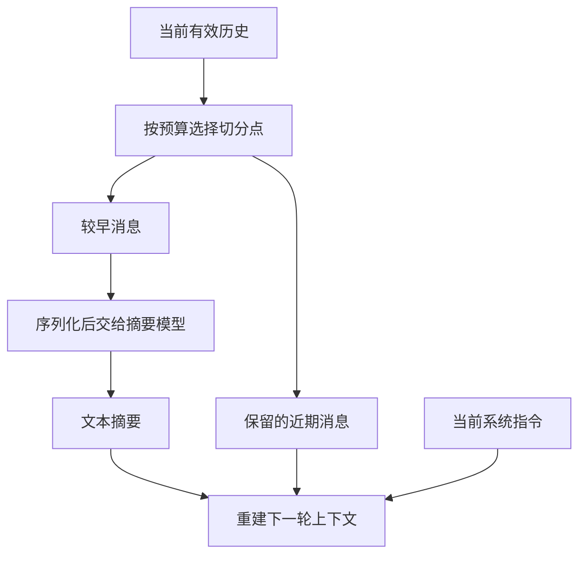
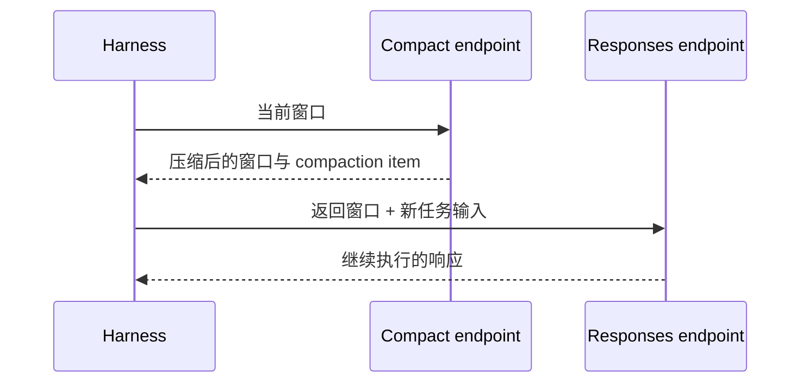

让 Agent 修改一套支付代码，它会先读实现，再读协议，接着改代码、跑测试、修测试。十几轮以后，窗口里已经堆满源文件、日志和工具结果。

这时界面上出现了一句：正在压缩上下文。

我最初对这件事的理解很朴素：把前面的对话总结一下，再接着聊。真正翻过 Pi 和 Codex 的源码后，才发现这句话省略了最关键的部分：**谁选择进入摘要的消息，近期内容怎样保留，摘要最终又以什么身份进入下一次请求？**

这些细节直接影响 Agent 接下来会继续哪个目标、相信哪些事实，以及怎样找回早期证据。

这篇沿着一次微信支付改造任务，分别看客户端编排的文本摘要和 OpenAI Responses 的服务端压缩。Pi 源码固定在 `fdce48eb`，Codex 固定在 `c419fd01`；API 文档核对于 2026 年 10 月 24 日。[^pi-compact] [^codex-compact] [^api]

## 先看模型实际收到的东西

在支付任务里，用户提出的要求可能只有几句话：

```text
新订单接入微信 H5 支付。
历史支付宝订单继续兼容。
保留签名校验、金额校验和回调幂等。
补齐测试，给出验证结果。
```

执行过程却会产生一长串消息。下面是结构示意，文件名和调用内容经过简化：

```text
user       支付改造要求
assistant  调用 read(service.ts)
tool       返回支付服务源码
assistant  调用 read(provider.ts)
tool       返回上游接口实现
assistant  调用 edit(service.ts, ...)
tool       修改成功
assistant  调用 test(...)
tool       返回失败用例和日志
user       补充：历史订单仍按原通道处理
assistant  调用 read(failing-test.ts)
tool       返回测试文件
```

理解上下文管理时，我会同时看三个东西：**磁盘上的会话记录、界面的对话展示、实际发给模型的请求。**

会话记录负责持久化；界面负责呈现；请求由运行时根据当前分支、压缩边界、扩展钩子和 provider 协议组装。它们各有自己的表示。

Pi 提供了一个很直观的例子：内部有 `compactionSummary`、`custom` 等消息类型，`convertToLlm()` 会将它们转换成模型接口接受的消息；标记为排除上下文的 shell 执行记录则在这里被过滤。[^pi-messages]

因此，要确认“那条日志还在模型眼前吗”，最直接的证据是这一轮的请求体。

## 本地压缩：Harness 重新组织下一轮输入

这里的“本地”，说的是**编排位置**。客户端决定摘要范围、保留策略和恢复方式，摘要生成仍然可以调用远端模型。

Pi 的内置压缩大致沿着这条链路执行：



切分点决定哪些内容进入摘要、哪些内容原样继续使用。摘要完成后，运行时把它和保留消息组合起来，构造新的工作上下文。

这个过程里有三个细节，值得展开看。

### 切分点需要照顾工具调用

Pi 从近期消息向前累计估算 token，寻找符合 `keepRecentTokens` 预算的保留边界。这个快照的默认值是 `20,000` tokens，配置可以调整。[^pi-compact]

工具调用还带来一层结构要求：assistant 发出的调用与后面的工具结果相互关联。Pi 的切分逻辑会选择合适的 user 或 assistant 边界，照顾调用和结果的连续关系。

假设最近的测试输出非常大，机械地按字符切割容易让新上下文从一段工具结果中间开始。合理的边界应该让模型知道：这段结果对应什么调用，当时准备验证什么。

所以，“保留最近 20k”表达的是预算目标，最终边界还要满足消息结构。

### 摘要请求有自己的信息筛选

选出的旧消息也会经过转换。Pi 的 `serializeConversation()` 把它们整理成带标签的文本：

```text
[User]: 接入微信 H5，保留历史订单兼容。

[Assistant tool calls]: read(path="service.ts")

[Tool result]: 支付服务源码……
```

这个快照会保留用户文本、助手可见文本、工具调用参数和工具结果文本；thinking 块在这条摘要序列化路径中被略过。每条工具结果进入摘要时还有 `2,000` 字符的上限。[^pi-serialize]

这意味着一次压缩里至少存在两次信息选择：先选择历史范围，再选择这些历史以什么形式进入摘要模型。

一条上万字符的测试日志，摘要模型实际收到的可能只是截取后的文本。需要精确保留的 requestId、错误码和时间戳，适合另外保存到可追溯的记录里。

### 近期消息通常走保留路径

完整地看，Pi 把材料分成 `messagesToSummarize` 和保留尾部。若切分点落在同一个用户轮次内部，还会提取 `turnPrefixMessages`，为该轮前半段生成补充摘要，帮助尾部继续保持任务语境。[^pi-compact]

所以，对“摘要时会带上近期消息吗”这个问题，我会给出一个带实现范围的回答：

**Pi 的这条路径主要摘要较早部分，近期部分原样保留；跨越轮次内部的切分，还会为该轮前缀补充摘要。**

这也解释了为什么“摘要模型看到的上下文”和“压缩后工作模型看到的上下文”应该分别检查。

## 摘要最后放在哪里

假设摘要模型给支付任务生成了下面这段内容。它是为解释机制编写的示意：

```text
目标：新订单接入微信 H5，历史支付宝订单沿用原通道。
约束：保留签名、金额校验和回调幂等。
进展：下单实现已修改；新增回调测试仍在修复。
下一步：检查重复回调测试，随后运行类型检查与 lint。
来源：service.ts、provider.ts、支付测试目录。
```

Pi 在 session 里保存一个压缩条目，记录摘要、压缩前 token 数和首条保留记录的 ID。之后构造上下文时，由这个条目定位保留尾部。

发送给模型前，`compactionSummary` 会转换成一条 `user` 消息，正文带摘要说明和 `<summary>` 标签。系统指令按系统上下文继续提供。[^pi-session] [^pi-messages]

下一轮的概念结构因此是：

```text
system     当前系统指令
user       历史摘要
assistant  保留的近期工具调用
tool       对应工具结果
user       后续追加的要求
```

这里展示的是 Pi 的转换约定。其他 Harness 可以采用自己的注入格式。

Codex 的本地摘要路径就有自己的重建逻辑：它提取真实用户消息，在预算内选择保留内容，再组合摘要和重新构建的上下文。阅读 Codex 时，应沿着 `build_compacted_history()` 检查实际排序和保留规则。[^codex-compact]

**“做文本摘要”是一类方案，具体请求长相由 Harness 决定。**

## 远程压缩：服务端返回可续接的状态

OpenAI Responses 还提供服务端压缩。应用提交上下文后，服务端执行压缩，返回用于后续请求的 compaction item。客户端按接口协议继续携带这个状态。[^api]

概念上，它包含这样的结构；实际 ID 和载荷由服务端生成：

```json
{
  "type": "compaction",
  "encrypted_content": "<服务端返回的载荷>"
}
```

公开接口把它描述为 opaque，也就是应用按整体传递的状态。客户端可以检查字段、保存 item、继续请求；内部表示和解码机制属于服务端实现。[^api-item]

从工程角度看，文本摘要允许开发者直接审阅摘要正文；compaction item 则提供服务端定义的续接协议。两者把控制权放在不同位置。

### 两种触发方式

Responses 提供两种调用形态。普通 `/responses` 请求可以通过 `context_management` 和 `compact_threshold` 配置自动压缩；应用也可以显式调用 `/responses/compact`，拿到压缩后的下一窗口输入。[^api]

下面用独立端点演示同一个支付任务。`currentInput` 表示应用收集的当前窗口消息和工具交互；`model` 由应用配置为支持该能力的模型。

```ts
const compacted = await client.responses.compact({
  model,
  input: currentInput,
})

const response = await client.responses.create({
  model,
  input: [
    ...compacted.output,
    {
      role: "user",
      content: "继续修复重复回调测试，再汇总验证结果。",
    },
  ],
  store: false,
})
```

这里最重要的是 `...compacted.output`：**将返回的窗口整体作为下一轮输入基础。** 它可以同时包含保留消息和 compaction item。

自动模式则把阈值交给服务端，响应过程中产生 compaction item。应用继续沿用输入数组串接或 `previous_response_id` 串接的对应契约。[^api]



独立端点让客户端掌握调用时机；压缩结果的表示和消费由服务端协议定义。

## 在 Codex 里，触发来源和实现路径分开看

研究 Codex 时，我曾经把 `/compact`、自动压缩和远程 V2 混在一起。源码里的元数据提供了更清楚的分法：[^codex-remote]

| 问题 | 对应维度 |
| --- | --- |
| 谁启动了这次操作？ | 手动命令、自动预算等 trigger |
| 采用哪条执行路径？ | 本地摘要、远程 compaction 等 implementation |
| 在什么阶段发生？ | turn 前、turn 内、独立操作等 phase |

`/compact` 描述用户入口；自动阈值描述运行时入口。具体采用哪种实现，还要结合 provider 能力和运行配置判断。

另外，Codex 源码中的远程 V2 编排与 Responses API 的自动压缩参数分属两个层次。前者包含尝试、安装新历史和失败处理；后者定义应用与 API 之间的调用契约。

排查一次真实运行时，我会先找请求端点、返回 item 和压缩元数据，再把它们对应到源码路径。

## 压缩以后，哪些东西值得另存

两种压缩都在用更少的输入承接前面的工作。对支付任务来说，可以按信息用途选择保存方式：

| 信息 | 合适的载体 |
| --- | --- |
| 当前目标、约束、待办 | 摘要或任务笔记 |
| 支付实现与技术不变量 | 代码、测试与集成文档 |
| 原始错误行、requestId、精确时间 | 日志或可检索的会话历史 |
| 以后任务可复用的工作习惯 | 跨会话记忆 |

这个划分给了我一个实际的检查方法：压缩后让 Agent 继续当前任务，检查目标和下一步；再追问一条早期原始证据，检查它怎样找到来源。

前一个问题考察任务连续性，后一个问题考察证据恢复。它们需要各自的存储和验证路径。

也正是在这里，上下文压缩开始连接到更完整的上下文管理：**运行时怎样保存任务状态，怎样打开下一窗口，又怎样让模型按需回看旧历史。**

下一篇继续拆解这条执行链。

---

*「Agent 上下文工程」第一篇。系列后续：[Notes、History 与任务恢复](/posts/agent-context-management/) · [Codex 跨会话记忆](/posts/codex-cross-session-memory/)。*

## 参考资料

[^pi-compact]: [Pi：压缩准备、切分边界与摘要生成](https://github.com/earendil-works/pi/blob/fdce48eb404ec014adaf2ac10a3a53bc6b1740c2/packages/coding-agent/src/core/compaction/compaction.ts)，本文固定提交 `fdce48eb`。
[^pi-messages]: [Pi：内部消息到 LLM 消息的转换](https://github.com/earendil-works/pi/blob/fdce48eb404ec014adaf2ac10a3a53bc6b1740c2/packages/coding-agent/src/core/messages.ts)。
[^pi-serialize]: [Pi：摘要序列化与工具结果长度限制](https://github.com/earendil-works/pi/blob/fdce48eb404ec014adaf2ac10a3a53bc6b1740c2/packages/coding-agent/src/core/compaction/utils.ts)。
[^pi-session]: [Pi：session 压缩条目与上下文投影](https://github.com/earendil-works/pi/blob/fdce48eb404ec014adaf2ac10a3a53bc6b1740c2/packages/coding-agent/src/core/session-manager.ts)。
[^codex-compact]: [Codex：本地摘要与历史重建](https://github.com/openai/codex/blob/c419fd01a70dd1d05356da443ac44328bda2e6f4/codex-rs/core/src/compact.rs)，本文固定提交 `c419fd01`。
[^api]: OpenAI 官方文档，[Compaction](https://developers.openai.com/api/docs/guides/compaction)，核对日期为 2026-10-24。模型与 provider 的实际能力以调用环境为准。
[^api-item]: [Codex 协议中的 Responses item 定义](https://github.com/openai/codex/blob/c419fd01a70dd1d05356da443ac44328bda2e6f4/codex-rs/protocol/src/models.rs)，可核对 compaction item 的字段表示；接口消费方式参见官方 Compaction 文档。
[^codex-remote]: [Codex：远程 compaction V2](https://github.com/openai/codex/blob/c419fd01a70dd1d05356da443ac44328bda2e6f4/codex-rs/core/src/compact_remote_v2.rs)及 [turn 编排](https://github.com/openai/codex/blob/c419fd01a70dd1d05356da443ac44328bda2e6f4/codex-rs/core/src/session/turn.rs)。
