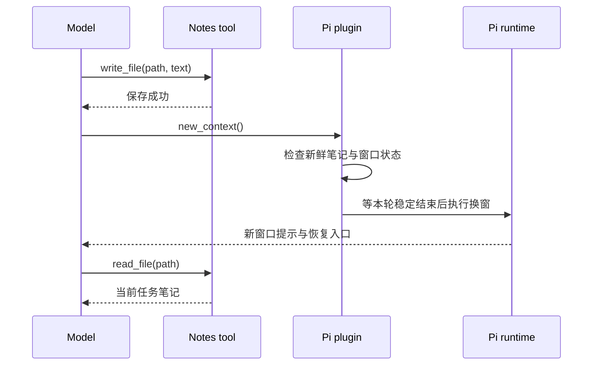

[上一篇](/posts/agent-context-compaction/)讨论了两条压缩路径：Pi 生成文本摘要，OpenAI Responses 返回服务端压缩状态。这一篇看另一种换窗策略：**Agent 先把任务状态写进 Notes，再打开新窗口，读取笔记继续工作。**

这里同样发生了信息提炼。Agent 把长对话里的目标、约束、决定和进度整理成一份较短的状态，交给下一个窗口；早期消息与工具结果保存在 History 中，需要具体细节时再查询。

完整流程是：

```text
旧窗口：执行任务 → 保存 Notes → 换窗
新窗口：读取 Notes → 继续任务，按需查询 History
```

一轮历史检索的受控测试将跨窗口执行设为预置条件，再向模型提交以下追问：

> 最早那条商户权限失败样本，对应的 requestId、上游错误码和发生时间分别是什么？请引用当时的 provider_evidence 整行，保留时间的小数秒和时区。

当前笔记里保存着任务进度，答案则留在较早的一条工具结果里。这个追问用来检查：新窗口恢复工作之后，能否继续定位旧窗口的原始记录。

下面结合 Pi 插件与 Codex 的实验性实现，拆开保存、换窗和恢复这条链路，再用这轮受控测试说明 History 怎样读取原文。

## 先把四种状态摆开

“Agent 记住了什么”这个问题，可以先拆成四个对象：

| 状态 | 保存什么 | 支付任务中的例子 |
| --- | --- | --- |
| 当前上下文 | 这一轮模型可见的消息与工具结果 | 刚读过的支付源码、测试输出 |
| 任务笔记 | 当前目标、约束、进度与下一步 | 微信 H5 改造做到哪一步 |
| 会话历史 | 用户消息、工具调用与原始结果 | 最早那条商户权限错误 |
| 长期记忆 | 后续任务可复用的背景 | 项目统一采用整数分表示金额 |

换窗主要围绕前三项展开。长期记忆在[第三篇](/posts/codex-cross-session-memory/)单独讨论。

这张表还有一个实际用途：遇到信息丢失时，可以先判断应该从哪里恢复。继续修测试需要任务状态；逐字引用 requestId 需要原始证据；判断当前代码行为则要回到源码和测试。

## Checkpoint 就是一份面向恢复的笔记

Checkpoint 在这里表示一个任务检查点。模型把当前工作整理成一份可读取的状态，供后面的窗口接手。

下面是根据支付实验整理的示意内容：

```markdown
# 微信支付改造

目标：新订单使用 WECHAT_H5 + CARD_VIRTUAL。
兼容：历史支付宝订单继续按原通道处理。

约束：
- 保留签名、金额和订单身份校验。
- 保留回调幂等和权益发放事务边界。

进度：
- 已完成下单通道修改。
- 重复回调测试正在修复。

下一步：
- 检查测试 mock 的签名和 requestId。
- 运行支付测试、类型检查和 lint。

证据入口：
- src/lib/payments/service.ts
- 支付测试目录
- 早期现场记录所在窗口和 item ID
```

它最重要的品质是“当前状态明确”。新窗口读完，应该知道用户现在要什么、哪些约束仍然有效、哪些工作已经验证、下一步从哪里开始。

同一任务使用稳定路径，并随进度更新正文，有助于新窗口直接定位最新状态；早期细节通过来源指针查询。

### 正文由模型编写，工具负责保存

在 Pi 的实验插件里，模型调用的 `notes` 工具可以接受这样的参数。以下展示调用形状，正文经过简化：

```json
{
  "action": "write_file",
  "path": "/root/notes/payments/production-readiness.md",
  "text": "# 微信支付改造\n目标：……\n进度：……\n下一步：……"
}
```

调用参数已经包含路径和完整正文。工具执行后负责持久化，并返回结果。因此，“生成笔记内容”和“保存这份内容”可以在一次工具调用里完成。

这里的路径是 Notes 命名空间里的逻辑地址。具体存储取决于工具实现：本地兼容插件把正文写进 session JSONL；`pi-notes-compaction` 则有自己的笔记存储。磁盘上的审计 Markdown 可以是从这些记录导出的阅读副本。[^pi-notes] [^early-notes]

排查存储时，沿着工具执行器查看写入位置，比根据 `.md` 后缀猜路径更直接。

## 换窗是一段控制流程

在测试的 Pi 插件中，模型可以调用 `new_context`。插件接到请求后检查前置状态，再通过 Pi 生命周期打开下一窗口。



这条链里，模型负责提炼状态、提出操作；工具负责保存；插件负责校验和安排换窗；运行时负责实际切换上下文。

**“笔记保存成功”是一条可以进入程序判断的事件。** Guard 就是这段前置检查：当保存条件满足时继续换窗，条件仍待满足时给出反馈，让模型补齐。[^pi-lifecycle]

Guard 能确认当前窗口里发生过符合条件的写入。笔记内容是否足以恢复目标，还需要另外检查。

### 提醒、校验与自动接管各有职责

几种机制经常出现在同一个插件里：

| 机制 | 运行时做什么 | 模型做什么 |
| --- | --- | --- |
| 预算提醒 | 按使用量注入提示 | 组织状态、调用保存和换窗 |
| `new_context` guard | 检查调用的前置条件 | 根据反馈补齐操作 |
| checkpoint 流程 | 安排保存阶段，结束后检查并换窗 | 在该阶段保存任务状态 |
| 预算引擎 | 管理剩余空间和窗口边界 | 在分配的执行空间内推进任务 |

所分析的 `pi-notes-compaction` 还提供 checkpoint 路径：程序在会话稳定时发起保存阶段，模型完成回复后，生命周期代码检查新鲜笔记和执行结果，再处理 rollover。[^pi-lifecycle]

**插件能够把保存阶段与后续换窗接成一段生命周期。** 这段流程需要同时处理保存失败、执行中断、重复触发和恢复入口。

完整的换窗策略涉及提醒代码、工具执行器、保存回执和稳定结束后的生命周期分支，源码分析需要覆盖这些环节。

## 新窗口带的是恢复线索

一次成功换窗后，新的请求可以从下面这些材料启动：

```text
系统指令与工具定义
上下文管理规则
当前窗口和上一窗口的身份
最近任务笔记的路径
读取笔记并继续任务的启动提示
```

这是一张恢复入口清单。笔记正文通过工具读取；更早的历史通过 History 查询。

消息角色则由 Harness 决定。Pi 的普通自定义消息转换可以投影成 `user`；Codex 原生运行时使用自己的 developer context 片段。XML 风格的 `<context_window>` 是正文标记，实际 role 应查看请求中的 `role` 字段。[^pi-messages] [^codex-hint]

## Codex 原生怎样提供 Notes 和 History

所分析的 Codex 实现包含一套实验性 History/Notes 扩展，以及与它协作的 token budget 策略。启用条件会检查功能配置、模型能力、provider 与认证状态。[^codex-budget]

组装上下文时，扩展会向 Codex backend 请求：

```text
alpha/notes/v2/thread_hint
```

返回的提示以 `notes.thread_hint` 片段进入上下文，运行时将窗口身份和这些线索组织成 developer 消息。之后，模型再按需调用 `notes.*` 或 `history.*`。[^codex-hint]

这里的 `developer` 是模型输入中的一种消息角色，用于承载应用或 Harness 提供的开发者指令。恢复规则和索引由系统预先组装；模型后续生成工具调用。

数据去向也能从客户端源码直接区分：

| 操作 | 对应实现的执行去向 |
| --- | --- |
| `notes.thread_hint` | Codex backend 的 Notes 路由 |
| `notes.write_file`、`notes.read_file` | Codex backend 的 Notes 路由 |
| `history.search_contents`、`history.read_item` | Codex backend 的 History 路由 |
| 本地 rollout 记录 | Codex 本地会话存储 |

这与 Pi 本地插件形成了一个关键对照：**接口可以很相似，存储和查询的执行位置由实现决定。**[^codex-tools]

本地保存的笔记一旦进入模型请求，其正文也会发给当前模型提供方。讨论数据控制时，应同时看存储位置、工具执行位置和模型请求内容。

## 受控案例：从旧窗口找回原始记录

这轮检索测试在代码任务里加入三个模拟支付现场。错误码、订单和 requestId 都是实验生成的数据，跨窗口执行是测试预先安排的条件。

其中最早一份现场包含：

```text
requestId: exp-wx-perm-7f29c4a1
upstreamCode: SIM_MERCHANT_SCOPE_DENIED
occurredAt: 2026-10-23T02:11:17.428+08:00
provider_evidence: channel=WECHAT_H5; requested_scope=CARD_VIRTUAL; app_scope=PHYSICAL_GOODS; policy_revision=sim-policy-r17
```

发出文章开头的排障追问前，先检查当前请求和 Notes，确认四项精确答案都留在较早历史里。

捕获到的工具调用顺序如下：[^history-lab]

1. 模型尝试重读现场 feed，工具返回该批现场已消费。
2. 模型调用 `history.search_contents`，搜索 `provider_evidence`。
3. 搜索命中第一窗口的原始工具结果，返回 item 定位信息。
4. 模型读取原文，两次参数校验反馈分别指出参数名和窗口 ID 问题。
5. 补齐 `window_id` 与 `item_id` 后，成功取回 1,684 字符原文。
6. 最终回答的 requestId、错误码、时间和完整证据行全部匹配。

这轮测试验证的是已有旧历史时的检索链路：模型经过参数纠正，取回原文并按字段交付答案。接近窗口容量时的自主换窗行为，需要结合真实预算使用和触发记录单独验证。

商户权限判断也有明确来源：现场里的 `requested_scope=CARD_VIRTUAL` 与 `app_scope=PHYSICAL_GOODS` 存在范围差异，再结合模拟错误码，形成当时的诊断依据。模型通过原始记录取回了这条判断链。

## History 的价值在于精确定位

这些工具通常提供由粗到细的读取路径：


搜索负责缩小范围；ID 负责定位；读取负责拿到可引用原文。一次结果可以只返回某条记录的一段字符范围，控制进入当前上下文的体积。

在所分析的 Codex 工具 schema 中，`list_items` 和 `search_contents` 可以按窗口过滤，`read_item` 使用 `window_id`、`item_id`，并支持字符范围参数。Pi 插件可以提供类似形状，具体参数仍应以当前工具定义为准。[^codex-tools]

因此，“模型会用 History”更适合表达为一种条件行为：当前任务需要早期细节，已有上下文和 Notes 提供恢复路线，工具能够定位对应原文，模型据此调用。

## 上下文管理的验收边界

上下文管理的验收包括触发来源和交接链路：

| 检查项 | 直接证据 |
| --- | --- |
| 换窗触发 | 预算使用、触发事件，以及阶段指令等输入 |
| 状态保存 | 成功回执及实际持久化内容 |
| 窗口切换 | 新窗口身份与首轮请求体 |
| 任务恢复 | 读回的笔记、后续动作和目标一致性 |
| 证据追溯 | 原始 item、返回内容与字段匹配 |

业务代码再按自己的测试和上线标准验收。这样能够区分恢复机制是否生效，以及恢复后完成的工作是否达到交付要求。

对一个长任务 Agent 来说，当前笔记提供继续工作的入口，History 提供回到证据的路线，运行时负责管理它们何时进入窗口。**这几层接起来，才形成可检查的任务连续性。**

跨会话记忆进一步面向后续任务，处理工作经历的提取、整理与复用。下一篇介绍这条记忆流水线。

---

*「Agent 上下文工程」第二篇。上一篇：[本地压缩与远程压缩](/posts/agent-context-compaction/)；下一篇：[Codex 跨会话记忆](/posts/codex-cross-session-memory/)。*

## 参考资料与案例说明

[^pi-notes]: [pi-notes-compaction 源码](https://github.com/IgorWarzocha/howaboua-pi-stuff/tree/a06eae4d141fae421a8d0108a4a560013d6508a8/packages/pi-notes-compaction)，本文所分析插件版本为 0.0.9。
[^pi-lifecycle]: [插件生命周期实现](https://github.com/IgorWarzocha/howaboua-pi-stuff/blob/a06eae4d141fae421a8d0108a4a560013d6508a8/packages/pi-notes-compaction/src/lifecycle.ts)，含换窗、保存检查与 checkpoint 路径。
[^pi-messages]: [Pi 消息转换](https://github.com/earendil-works/pi/blob/fdce48eb404ec014adaf2ac10a3a53bc6b1740c2/packages/coding-agent/src/core/messages.ts)。具体实验中的角色安排以捕获请求为准。
[^codex-hint]: [History/Notes 扩展](https://github.com/openai/codex/blob/c419fd01a70dd1d05356da443ac44328bda2e6f4/codex-rs/ext/history-notes/src/extension.rs)与 [session 上下文组装](https://github.com/openai/codex/blob/c419fd01a70dd1d05356da443ac44328bda2e6f4/codex-rs/core/src/session/mod.rs)。
[^codex-budget]: [Codex token budget 启用条件](https://github.com/openai/codex/blob/c419fd01a70dd1d05356da443ac44328bda2e6f4/codex-rs/core/src/session/token_budget.rs)。本文描述源码中的实验性实现，启用范围受功能配置和模型能力约束。
[^codex-tools]: [Codex Notes/History 工具 schema 与路由](https://github.com/openai/codex/blob/c419fd01a70dd1d05356da443ac44328bda2e6f4/codex-rs/ext/history-notes/src/tools.rs)。
[^early-notes]: 本地修改的 Codex 兼容插件将 Notes 正文记录于 session JSONL 的 `codex-context-note` 条目。存储行为由执行器和捕获请求核对。
[^history-lab]: 定向追溯测试预先安排跨窗口执行，并通过请求审计确认精确答案已从当前上下文与 Notes 中省略，再将 History 工具返回值和最终回答逐字段匹配。现场数据为模拟样本，案例结论限定为检索链路的行为。
