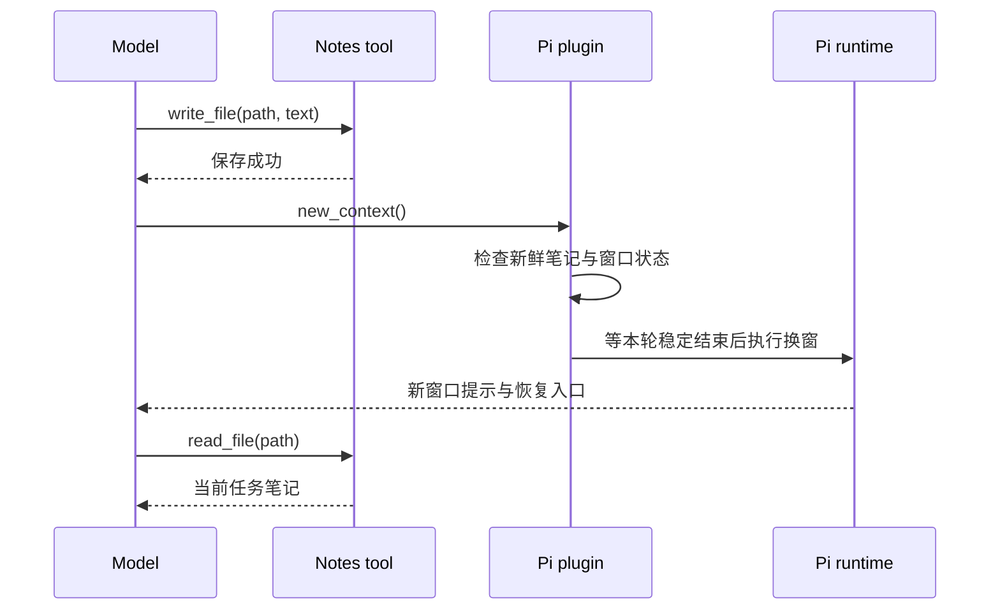

做支付改造实验时，我给 Agent 追加过一个追问：

> 最早那条商户权限失败样本，对应的 requestId、上游错误码和发生时间分别是什么？请引用当时的 provider_evidence 整行，保留时间的小数秒和时区。

这个问题很适合检验上下文管理。前面的代码任务已经持续了多个窗口，当前笔记里只有任务进度。答案藏在较早的一条工具结果里。

Agent 要先恢复正在做什么，再找到那份原文，最后按字段原值回答。**任务笔记和原始历史，在这里承担了两种不同的恢复职责。**

[上一篇](/posts/agent-context-compaction/)介绍了压缩怎样重组模型输入。这一篇继续看完整执行过程：谁写笔记，谁决定换窗，新窗口收到什么，以及 History 什么时候真正派上用场。

文章结合两套 Pi 插件实验与 Codex `c419fd01` 源码。实验在 2026 年 10 月 23 日归档；不同组别的插件、预算和触发条件会分别说明。

## 先把四种状态摆开

“Agent 记住了什么”这个问题，可以先拆成四个对象：

| 状态 | 保存什么 | 支付任务中的例子 |
| --- | --- | --- |
| 当前上下文 | 这一轮模型可见的消息与工具结果 | 刚读过的支付源码、测试输出 |
| 任务笔记 | 当前目标、约束、进度与下一步 | 微信 H5 改造做到哪一步 |
| 会话历史 | 用户消息、工具调用与原始结果 | 最早那条商户权限错误 |
| 长期记忆 | 后续任务可复用的背景 | 项目统一采用整数分表示金额 |

换窗主要围绕前三项展开。长期记忆在[第三篇](/posts/codex-cross-session-memory/)单独讨论。

这张表还有一个实际用途：遇到信息丢失时，可以先判断应该从哪里恢复。继续修测试需要任务状态；逐字引用 requestId 需要原始证据；判断当前代码行为则要回到源码和测试。

## Checkpoint 就是一份面向恢复的笔记

Checkpoint 在这里表示一个任务检查点。模型把当前工作整理成一份可读取的状态，供后面的窗口接手。

下面是根据支付实验整理的示意内容：

```markdown
# 微信支付改造

目标：新订单使用 WECHAT_H5 + CARD_VIRTUAL。
兼容：历史支付宝订单继续按原通道处理。

约束：
- 保留签名、金额和订单身份校验。
- 保留回调幂等和权益发放事务边界。

进度：
- 已完成下单通道修改。
- 重复回调测试正在修复。

下一步：
- 检查测试 mock 的签名和 requestId。
- 运行支付测试、类型检查和 lint。

证据入口：
- src/lib/payments/service.ts
- 支付测试目录
- 早期现场记录所在窗口和 item ID
```

它最重要的品质是“当前状态明确”。新窗口读完，应该知道用户现在要什么、哪些约束仍然有效、哪些工作已经验证、下一步从哪里开始。

我倾向于让同一任务使用一个稳定路径，随着进度更新正文。这样恢复时可以直接读取最新状态；早期细节通过来源指针查询。

### 正文由模型编写，工具负责保存

在 Pi 的实验插件里，模型调用的 `notes` 工具可以接受这样的参数。以下展示调用形状，正文经过简化：

```json
{
  "action": "write_file",
  "path": "/root/notes/payments/production-readiness.md",
  "text": "# 微信支付改造\n目标：……\n进度：……\n下一步：……"
}
```

调用参数已经包含路径和完整正文。工具执行后负责持久化，并返回结果。因此，“生成笔记内容”和“保存这份内容”可以在一次工具调用里完成。

这里的路径首先是 Notes 命名空间里的逻辑地址。具体存储取决于工具实现：早期兼容插件把正文写进本地 session JSONL；后来测试的 `pi-notes-compaction` 还有自己的笔记存储。磁盘上的审计 Markdown 可以是从这些记录导出的阅读副本。[^pi-notes] [^early-notes]

排查存储时，沿着工具执行器查看写入位置，比根据 `.md` 后缀猜路径更直接。

## 换窗是一段控制流程

在测试的 Pi 插件中，模型可以调用 `new_context`。插件接到请求后检查前置状态，再通过 Pi 生命周期打开下一窗口。



这条链里，模型负责提炼状态、提出操作；工具负责保存；插件负责校验和安排换窗；运行时负责实际切换上下文。

**“笔记保存成功”是一条可以进入程序判断的事件。** Guard 就是这段前置检查：当保存条件满足时继续换窗，条件仍待满足时给出反馈，让模型补齐。[^pi-lifecycle]

Guard 能确认当前窗口里发生过符合条件的写入。笔记内容是否足以恢复目标，还需要另外检查。

### 提醒、校验与自动接管各有职责

几种机制经常出现在同一个插件里：

| 机制 | 运行时做什么 | 模型做什么 |
| --- | --- | --- |
| 预算提醒 | 按使用量注入提示 | 组织状态、调用保存和换窗 |
| `new_context` guard | 检查调用的前置条件 | 根据反馈补齐操作 |
| checkpoint 流程 | 安排保存阶段，结束后检查并换窗 | 在该阶段保存任务状态 |
| 预算引擎 | 管理剩余空间和窗口边界 | 在分配的执行空间内推进任务 |

`pi-notes-compaction` 的固定版本还提供 checkpoint 路径：程序在会话稳定时发起保存阶段，模型完成回复后，生命周期代码检查新鲜笔记和执行结果，再处理 rollover。[^pi-lifecycle]

这样就能回答“保存 Notes 后能否由程序接着换窗”：**可以，插件能够把保存阶段与后续换窗接成一段生命周期。** 需要同时处理保存失败、执行中断、重复触发和恢复入口。

观察一个插件时，我会分别找提醒代码、工具执行器、保存回执和稳定结束后的生命周期分支。它们加起来，才构成完整策略。

## 新窗口带的是恢复线索

一次成功换窗后，新的请求可以从下面这些材料启动：

```text
系统指令与工具定义
上下文管理规则
当前窗口和上一窗口的身份
最近任务笔记的路径
读取笔记并继续任务的启动提示
```

这是一张恢复入口清单。笔记正文通过工具读取；更早的历史通过 History 查询。

128k 实验的窗口提示实际包含 `First context window id`、`Current context window id`、`Previous context window id` 和最近笔记路径，随后要求读取保存状态并继续。旧轨迹留在会话存储里，当前请求采用新的窗口投影。[^lab128]

消息角色则由 Harness 决定。Pi 的普通自定义消息转换可以投影成 `user`；Codex 原生运行时使用自己的 developer context 片段。XML 风格的 `<context_window>` 是正文标记，实际 role 应查看请求中的 `role` 字段。[^pi-messages] [^codex-hint]

## Codex 原生怎样提供 Notes 和 History

Codex 这个源码快照包含一套实验性 History/Notes 扩展，以及与它协作的 token budget 策略。启用条件会检查功能配置、模型能力、provider 与认证状态。[^codex-budget]

组装上下文时，扩展会向 Codex backend 请求：

```text
alpha/notes/v2/thread_hint
```

返回的提示以 `notes.thread_hint` 片段进入上下文，运行时将窗口身份和这些线索组织成 developer 消息。之后，模型再按需调用 `notes.*` 或 `history.*`。[^codex-hint]

这里的 `developer` 是模型输入中的一种消息角色，用于承载应用或 Harness 提供的开发者指令。恢复规则和索引由系统预先组装；模型后续生成工具调用。

数据去向也能从客户端源码直接区分：

| 操作 | 此快照的执行去向 |
| --- | --- |
| `notes.thread_hint` | Codex backend 的 Notes 路由 |
| `notes.write_file`、`notes.read_file` | Codex backend 的 Notes 路由 |
| `history.search_contents`、`history.read_item` | Codex backend 的 History 路由 |
| 本地 rollout 记录 | Codex 本地会话存储 |

这与 Pi 本地插件形成了一个关键对照：**接口可以很相似，存储和查询的执行位置由实现决定。**[^codex-tools]

本地保存的笔记一旦进入模型请求，其正文也会发给当前模型提供方。讨论数据控制时，应同时看存储位置、工具执行位置和模型请求内容。

## 支付实验：先验证恢复，再验证追溯

我实际跑了几组实验。它们分别回答不同问题，下面保留各自的条件。

### 18k 软预算：观察提醒后的自主换窗

第一组用 GLM-5.3-Flash 和本地兼容插件，从支付实现前的代码副本开始。迁入材料包含任务交接和五对代码读取调用，共 13 条消息，约 4.9 万字符。

两组执行同一个改造任务。一组使用较大配置窗口；另一组把实验软预算设为 18k tokens。

| 观察项 | 大窗口组 | 18k 软预算组 |
| --- | ---: | ---: |
| 经历窗口 | 1 | 3 |
| 预算提醒 | 0 | 2 |
| Notes 写入 | 0 | 3 |
| Notes 读取 | 0 | 2 |
| `new_context` 调用 | 0 | 2 |
| History 调用 | 0 | 0 |

预算组收到提示后，模型先写笔记，再调用换窗；新窗口读取同一路径的笔记，继续修测试。第一次恢复前，请求体里实际只有系统材料和恢复提示共三条输入。[^lab18]

这里的 18k 是实验配置的软预算，上游仍提供大窗口。早期尝试还暴露了输出额度问题：SDK 安全预留把输出压得很小，随后出现连续截断；调整实验捕获层的输出额度后，保存和恢复链路才顺利跑通。

这组实验最直接支持的是：**预算提醒可以引导模型完成“保存—换窗—读回—继续”这条链。**

业务验收另看代码评审。独立测试记录为 188 项通过、43 项数据库集成测试按条件跳过；核心后端切换落地，购买页提示、文档同步和数据库验收仍有待办。运行走到最终回复与业务交付完整度，需要分别记录。[^lab18]

### 128k SDK：观察阶段交接和 guard

第二组换成上游 `pi-notes-compaction`，固定到 `a06eae4d`，通过 Pi SDK 加载，模型配置窗口为 128,000 tokens。任务安排审查、实现和复核三个阶段，阶段之间要求保存交接状态。

归档记录显示：

```text
模型请求：73 次
经历窗口：2 个
new_context 调用：2 次
成功窗口转换：1 次
Notes 保存回执：3 次
自动预算提醒：0 条
History 调用：0 次
```

第一次换窗请求收到 guard 反馈，模型补写笔记后再次请求，成功进入下一窗口。换窗前记录约 76,151 tokens，占配置窗口 59.5%。[^lab128]

这个比例曾经让我疑惑：窗口还有余量，为什么已经换了？

看完任务和事件就清楚了：**这次换窗由任务阶段交接推动。** 该次运行覆盖了笔记保存、guard 和恢复链路；预算阈值行为由另一组实验观察。任务原本设计了两次交接，实际记录支持一次成功转换。

这组结果也解释了 History 的零调用：笔记已经覆盖继续工作所需状态，模型沿着 Notes 恢复即可。

### 精确追溯：让答案留在旧窗口

为了观察 History，我在另一组代码任务里加入三个模拟支付现场。错误码、订单和 requestId 都是实验生成的数据。

其中最早一份现场包含：

```text
requestId: exp-wx-perm-7f29c4a1
upstreamCode: SIM_MERCHANT_SCOPE_DENIED
occurredAt: 2026-10-23T02:11:17.428+08:00
provider_evidence: channel=WECHAT_H5; requested_scope=CARD_VIRTUAL; app_scope=PHYSICAL_GOODS; policy_revision=sim-policy-r17
```

代码阶段经过四次换窗。达到阶段预算后，我重开同一 session，追加文章开头的排障追问。审计先检查了追问时的请求和 Notes，确认四项精确答案都留在较早历史里。

后面的工具链很有意思：[^history-lab]

1. 模型尝试重读现场 feed，工具返回该批现场已消费。
2. 模型调用 `history.search_contents`，搜索 `provider_evidence`。
3. 搜索命中第一窗口的原始工具结果，返回 item 定位信息。
4. 模型读取原文，两次参数校验反馈分别指出参数名和窗口 ID 问题。
5. 补齐 `window_id` 与 `item_id` 后，成功取回 1,684 字符原文。
6. 最终回答的 requestId、错误码、时间和完整证据行全部匹配。

追溯阶段共五轮响应，配置单价估算约 `$0.00127`。这是一轮带参数纠正的成功检索。

商户权限判断也有明确来源：现场里的 `requested_scope=CARD_VIRTUAL` 与 `app_scope=PHYSICAL_GOODS` 存在范围差异，再结合模拟错误码，形成当时的诊断依据。模型通过原始记录取回了这条判断链。

## History 的价值在于精确定位

这些工具通常提供由粗到细的读取路径：


搜索负责缩小范围；ID 负责定位；读取负责拿到可引用原文。一次结果可以只返回某条记录的一段字符范围，控制进入当前上下文的体积。

在 Codex 固定快照的 schema 中，`list_items` 和 `search_contents` 可以按窗口过滤，`read_item` 使用 `window_id`、`item_id`，并支持字符范围参数。Pi 插件可以提供类似形状，具体参数仍应以当前工具定义为准。[^codex-tools]

因此，“模型会用 History”更适合表达为一种条件行为：当前任务需要早期细节，已有上下文和 Notes 提供恢复路线，工具能够定位对应原文，模型据此调用。

## 我会怎样验收上下文管理

经过这些实验，我会把验收拆成四件事：

| 检查项 | 直接证据 |
| --- | --- |
| 状态保存 | 成功回执及实际持久化内容 |
| 窗口切换 | 新窗口身份与首轮请求体 |
| 任务恢复 | 读回的笔记、后续动作和目标一致性 |
| 证据追溯 | 原始 item、返回内容与字段匹配 |

业务代码再按自己的测试和上线标准验收。这样能够区分恢复机制是否生效，以及恢复后完成的工作是否达到交付要求。

对一个长任务 Agent 来说，当前笔记提供继续工作的入口，History 提供回到证据的路线，运行时负责管理它们何时进入窗口。**这几层接起来，才形成可检查的任务连续性。**

下一篇把时间拉到下一次会话：一次工作经历，怎样被整理成以后仍然有用的记忆。

---

*「Agent 上下文工程」第二篇。上一篇：[本地压缩与远程压缩](/posts/agent-context-compaction/)；下一篇：[Codex 跨会话记忆](/posts/codex-cross-session-memory/)。*

## 参考资料与实验说明

[^pi-notes]: [pi-notes-compaction 固定源码](https://github.com/IgorWarzocha/howaboua-pi-stuff/tree/a06eae4d141fae421a8d0108a4a560013d6508a8/packages/pi-notes-compaction)，128k SDK 实验使用版本 0.0.9。
[^pi-lifecycle]: [插件生命周期实现](https://github.com/IgorWarzocha/howaboua-pi-stuff/blob/a06eae4d141fae421a8d0108a4a560013d6508a8/packages/pi-notes-compaction/src/lifecycle.ts)，含换窗、保存检查与 checkpoint 路径。
[^pi-messages]: [Pi 消息转换](https://github.com/earendil-works/pi/blob/fdce48eb404ec014adaf2ac10a3a53bc6b1740c2/packages/coding-agent/src/core/messages.ts)。具体实验中的角色安排以捕获请求为准。
[^codex-hint]: [History/Notes 扩展](https://github.com/openai/codex/blob/c419fd01a70dd1d05356da443ac44328bda2e6f4/codex-rs/ext/history-notes/src/extension.rs)与 [session 上下文组装](https://github.com/openai/codex/blob/c419fd01a70dd1d05356da443ac44328bda2e6f4/codex-rs/core/src/session/mod.rs)。
[^codex-budget]: [Codex token budget 启用条件](https://github.com/openai/codex/blob/c419fd01a70dd1d05356da443ac44328bda2e6f4/codex-rs/core/src/session/token_budget.rs)。本文描述该固定快照的实验实现。
[^codex-tools]: [Codex Notes/History 工具 schema 与路由](https://github.com/openai/codex/blob/c419fd01a70dd1d05356da443ac44328bda2e6f4/codex-rs/ext/history-notes/src/tools.rs)。
[^early-notes]: 18k 组使用本机修改的 Codex 兼容插件，Notes 正文记录于 session JSONL 的 `codex-context-note` 条目。本文按执行器和请求捕获结果描述该配置。
[^lab18]: 本机实验归档 `gduf-context`：统计依据为 `RESULTS.md`、`audit.json`、独立验证记录及代码评审；预算组请求 `04.json`、`32.json` 对应两次新窗口的恢复入口。18k 为实验软预算，费用按本机配置单价估算。
[^lab128]: 本机 SDK 运行 `2026-10-23T06-44-52.819Z`：统计依据为 `summary.json`、`context-events.json` 和逐轮请求记录；配置窗口 128,000，最大输出 4,096 tokens。文中公开汇总与提示结构，实验身份标识留在本机归档。
[^history-lab]: 本机实验归档 `history-retrieval`：定向追溯运行 `2026-10-22T17-31-21.024Z`，核对 `probe-request-audit.json`、`history-calls.json`、`history-results.json` 与 `verified-retrieval.json`。运行 ID 使用 UTC 时间；实验结果于 2026-10-23 按 Asia/Shanghai 归档。现场数据为 synthetic fixture，代码阶段仍有扩展待办。
