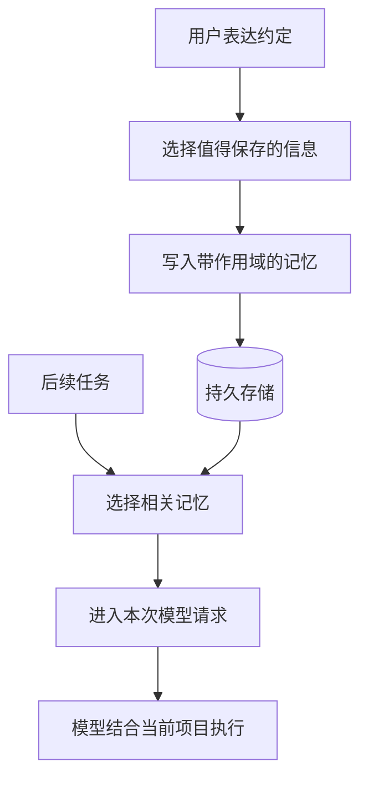
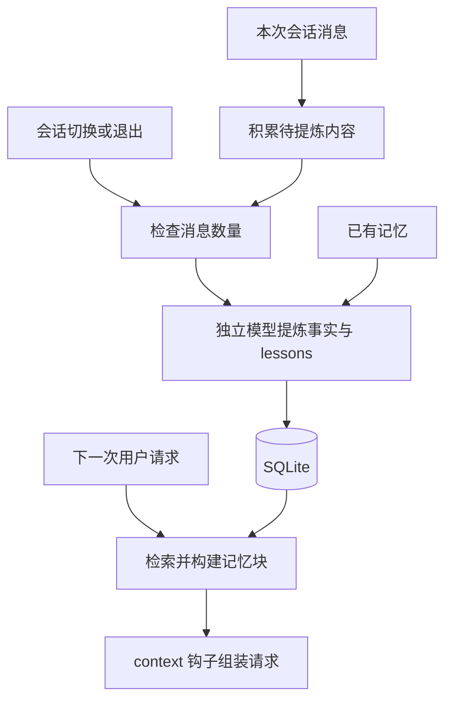
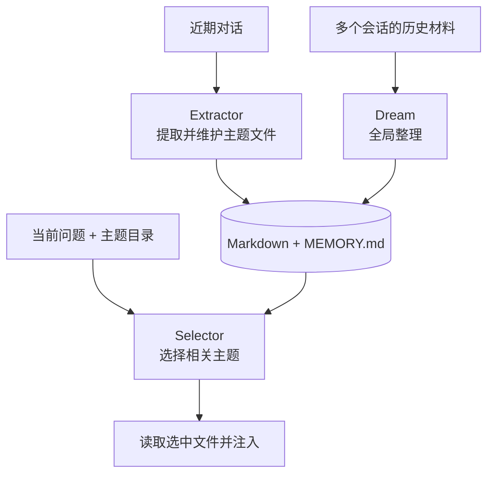

支付项目原先约定新增测试使用 Jest，用户后来明确要求：“后续新增测试统一用 Vitest，历史 Jest 用例逐步迁移。”下一次修改回调时，Agent 应该找到这次纠正，并在支付项目范围内使用。这里至少包含三件事：判断这句话值得保存，维护旧约定与新约定的关系，再在后续相关请求里取回来。

[上一篇的 Codex 记忆流水线](/posts/codex-cross-session-memory/)把历史会话摘要和全局入口交给后台模型整理。Pi 的扩展机制允许插件采用另一组组合：主模型直接调用记忆工具、会话结束后单独提炼，或安排独立模型挑选和维护文件。

**记忆插件的主要差异，落在保存判断、整理时机和请求注入这三个执行位置。**

下面以三种 Pi 插件为主线，沿着同一条 Jest → Vitest 的约定变更走一遍。Claude-mem 和 QMD 分别补充“执行过程怎样留下记忆”和“文件怎样被搜索”这两个环节。示例内容均为机制示意，源码链接指向所分析的固定版本。

## 从一句话到下一次模型请求

记忆要影响后续工作，需要完成这样一条路径：



保存和读取各有两个参与者：模型负责语义判断，程序负责工具执行、存储和请求组装。插件通过生命周期钩子选择介入时机，例如用户回合开始前、会话切换前或退出时。

因此，“这个插件支持记忆”还需要展开成几个具体问题：谁生成正文，哪个事件触发保存，项目身份怎样确定，后续请求带上标题还是完整事实，以及用户纠正后由谁更新。

下面先看执行路径最直接的一种。

## 主模型调用工具：memory-layer

`@ryan_nookpi/pi-extension-memory-layer` 注册 `memory_remember`、`memory_recall`、`memory_forget` 和 `memory_list`。主模型根据用户表达和工具说明生成调用，插件负责执行。[^layer-main]

例如，保存测试约定的参数可以写成：

```json
{
  "scope": "project",
  "tier": "profile",
  "topic": "testing",
  "title": "新增测试框架",
  "content": "支付项目后续新增测试统一使用 Vitest，历史 Jest 用例逐步迁移。"
}
```

这是 `memory_remember` 的示意调用。`scope` 表示适用范围，`tier` 表示读取优先级，`topic` 和 `title` 帮助组织、定位正文。

**这条路径里的 AI 就是当前工作模型。** 它已经理解了对话，同时生成记忆正文和工具参数；插件的保存函数随后更新主题文件、tier 元数据和索引。用户也可以通过 `/remember` 发起保存。

### 项目身份先于相关性

该插件提供三种 scope：用户记忆跨项目共享，项目记忆跟随项目身份，会话级 `agent` 记忆跟随当前会话。持久条目采用 Markdown 主题文件，tier 存在相邻的 JSON 文件中；会话条目使用 session custom entries。[^layer-storage]

项目身份依次参考 origin 远端、根提交和目录路径。采用相同 origin 的多个检出目录通常会落入同一项目空间。[^layer-project]

这个选择会直接影响召回：将测试约定放入项目 scope，读取范围便跟随支付项目；放入用户 scope，它就会成为跨项目可见的材料。同一套搜索算法，面对这两个数据集合，适用范围由保存位置决定。

若团队希望各分支采用独立测试约定，接入层需要进一步定义分支范围。仓库共享身份与分支隔离对应两种协作需求。

### 每轮先给标题，再按需读取正文

`before_agent_start` 会构建记忆标题索引，追加到系统提示词。索引按 `profile → log → note` 排序；正文通过 `memory_recall` 读取。[^layer-inject]

新任务开始时，模型可能先看到：

```text
# Memory Index
- [project/profile] testing/新增测试框架
```

随后调用：

```json
{"query": "测试框架", "scope": "project"}
```

查询返回匹配摘要和条目 ID，模型可以再按 ID 读取全文。这里采用“入口常驻、正文按需读取”的分层方式，与 Codex 总摘要提供历史导航的思路相近。

标题索引把大部分正文留在存储层，也把一次读取决定交给主模型。记忆标题的表达质量因此很重要：“新增测试框架”比“上次的事”更容易帮助模型判断相关性。索引更新也会改变系统提示词后缀，实际缓存收益需要结合提供方和捕获请求衡量。

### 同一条约定怎样修正

该版本的持久化规则是：在同一 scope、topic 下保存相同 title，会更新对应条目。[^layer-storage]

假设旧条目是“后续新增测试使用 Jest”，用户改成 Vitest，模型可以复用 `testing / 新增测试框架` 这组定位，把正文更新为当前约定。使用另一标题保存时，则可能形成两个并存条目。

下一次支付测试任务到来时，标题仍指向同一条约定，按 ID 读出的正文已经变成 Vitest。这里的前提是主模型完成了保存调用，并复用了原条目身份。

所以这里的冲突消解依赖一条明确链路：**模型识别纠正 → 复用条目身份 → 程序更新正文。** 存储函数能够准确执行更新，语义上应该更新哪一条，仍由调用者判断。

## 会话结束后提炼：@samfp/pi-memory

`@samfp/pi-memory` 把一部分保存判断移到会话结束阶段。它在 `agent_end` 收集消息，在会话切换前和退出时检查积累量；达到门槛后，调用独立 `pi` 进程进行提炼。[^sam-runtime]

提炼输入包含对话、工作目录和已有记忆，输出分成 semantic facts 与 lessons。前者表达偏好、工具习惯等键值事实，后者保存纠正和已验证经验。记忆写入 SQLite，检索采用 FTS5，也支持可选 embedding。[^sam-consolidator] [^sam-injector]



这条路径减少了主模型在工作过程中主动保存的要求，同时增加了额外的模型请求和退出阶段的等待。Vitest 纠正会先留在待提炼对话中，随后经过提取、过滤和写入，才成为下一次请求可读取的事实。

### 结构化 key 承担部分冲突处理

假设提炼模型把这次纠正识别为值得保存的项目约定，结果可以包含这样的**示意事实**：

```json
{
  "key": "project.payments.testing_framework",
  "value": "后续新增测试使用 Vitest，历史 Jest 用例逐步迁移。",
  "confidence": 0.9
}
```

**这里的项目范围由 key 约定表达。** SQLite 的 semantic 表以全局 key 为主键，`payments` 编码在 key 中；lessons 表另有 `project` 字段，会话提炼产生的 lesson 由程序标记当前项目。读取器根据工作目录推导项目 slug，再用它筛选 `project.<slug>.*` 事实和默认读取的 lessons。[^sam-store] [^sam-consolidator] [^sam-injector]

`setSemantic` 使用 key 做 upsert，旧事实 confidence 较高时保留旧值，其余更新覆盖同一 key。假设该 key 原先保存 Jest、confidence 为 `0.85`，上面的 `0.9` 会将正文改成 Vitest；若旧值为 `0.95`，同一次提炼则会保留 Jest。这组数值用于展示程序条件。[^sam-store]

它把冲突问题拆成两层：模型负责把同一件事归到稳定 key，数据库函数负责按 key 和 confidence 更新。**纠正能否生效，取决于 key 一致性与置信度条件。** 模型给出的 confidence 属于提炼输出，可信程度适合通过真实纠正样本检验。

### 召回内容临时进入请求

默认读取路径在 `before_agent_start` 根据本轮问题构建相关记忆块，再由 `context` 钩子将它插入最近一条用户消息之前，表现为一条临时 `user` 消息。会话持久历史继续由 Pi 管理。[^sam-runtime]

沿着新值已写入的分支继续看：下一轮支付测试问题命中 `project.payments.testing_framework` 后，Vitest 约定进入临时记忆块。semantic facts 按问题检索并补充同组 key；lessons 默认读取当前项目与全局条目，也可以配置为相关性筛选。[^sam-injector]

“临时”描述持久化位置：这份记忆块参与本次模型调用，在工具调用续轮中也会被组装进去。原始 SQLite 条目、请求里的临时投影和 session 历史是三个独立对象。

这种注入方式把系统提示词与动态记忆分开，有利于保留更稳定的提示词前缀。实际缓存命中还受到消息位置、正文变化和提供方策略影响。

## 独立模型分工：pi-project-memory

`pi-project-memory` 把读写进一步拆成 selector、extractor 和 dream 三种后台角色，主模型也可以直接使用文件工具维护记忆。主题正文保存在 Markdown，`MEMORY.md` 提供索引。[^project-prompts]



Selector 根据文件名和 description 选择记忆文件。这是一次单独的模型判断，选择粒度落在主题文件。Extractor 根据近期对话维护事实，Dream 面向跨会话材料进行整理。[^project-config] [^project-runtime]

三个角色把“哪些文件值得读”“本次对话留下什么”“多次对话怎样整合”拆开，也让后台 token、并发控制、停止和错误恢复成为日常运行的一部分。源码提供独立角色的用量记录，接入时适合同时检查主任务成本与记忆维护成本。

在同一组示意中，原有测试主题文件写着 Jest；Extractor 或主模型收到纠正后，将主题正文维护为“后续新增测试采用 Vitest，历史 Jest 用例逐步迁移”，并同步索引描述。下一次支付测试问题交给 Selector，它根据目录选中测试主题，文件正文再进入工作模型上下文。

它的提示词还要求保留 Why 和 How to apply。主题可以进一步注明“原因是迁移后的工具链已统一；适用于后续新增用例”，帮助后续模型判断适用范围。这条路径中的纠正由文件编辑完成，语义一致性由编辑模型和后续 Dream 整理共同维护。[^project-prompts]

<details>
<summary>补充：提炼、调度与注入预算</summary>

这些参数分别约束触发时机、单次执行量和读取预算：

| 实现与环节 | 所分析版本的默认设置 |
| --- | --- |
| `memory-layer`<br>标题索引 | 200 行截断预算 |
| `@samfp/pi-memory`<br>会话提炼 | 至少积累 3 条用户消息；<br>子进程 45 秒超时；<br>整体 60 秒兜底 |
| `@samfp/pi-memory`<br>请求注入 | 默认最多 50 条 lessons；<br>记忆块采用 8000 字符预算 |
| `pi-project-memory`<br>Selector | 最多选择 5 个文件 |
| `pi-project-memory`<br>Extractor | 每轮安排提炼；<br>空闲刷新阈值 120 秒；<br>最多 5 个 agent turns |
| `pi-project-memory`<br>Dream | 24 小时间隔；<br>至少 5 个其他更新会话；<br>最多 50 个 agent turns |

调度是否触发、提炼是否完成、产物是否进入请求，适合分别记录。[^layer-inject] [^sam-runtime] [^sam-injector] [^project-config] [^project-runtime]

</details>

## Claude-mem：从执行记录中生成观察

Claude-mem 提供另一种写入粒度：把工具执行及结果作为观察输入。在本次核对的版本里，`PostToolUse` 和 `PostToolUseFailure` 钩子将事件送入处理路径，`Stop` 触发总结，`SessionStart` 提供记忆上下文。下面聚焦本地 worker 路径。[^cm-hooks]

观察模型按结构化格式生成 title、facts、narrative、concepts 和相关文件等字段，解析器处理输出，存储层持久化观察与会话总结。[^cm-prompt] [^cm-store]

例如一次测试迁移可以留下这样的**示意观察**：

```text
标题：支付模块已采用 Vitest 运行新增测试
事实：新增回调用例已通过 Vitest
来源：对应会话、工具执行与涉及文件
```

下一次任务可以通过启动上下文取得历史入口，再沿 `search → timeline → get_observations` 先看候选、再看相邻记录、最后取选中正文。[^cm-search]

这里需要保留“历史观察”和“当前规范”两种语义。某次 Jest 测试曾经通过，后来 Vitest 用例也通过，两条记录都可能准确描述各自时间点。回答“当前新增测试采用什么框架”，需要结合后续明确决定、最新配置和记录时间判断。

**自动记录执行经历，与维护一项当前有效的约定，拥有各自的验收标准。** 前者检查事件及来源是否准确，后者检查变更后哪个事实应指导新任务。

## QMD 负责把已有文件找出来

`jayzeng/pi-memory` 保存长期 Markdown、daily logs 和 scratchpad，并可通过 QMD 为这些文件建立检索索引。插件的保存、退出摘要和请求注入仍由自身逻辑负责；QMD 在其中提供关键词、语义及组合搜索入口。[^jay]

可以把这个组合读成：

```text
插件或模型写 Markdown
  → QMD 更新文件索引和 embedding
  → 插件用当前问题查询
  → 读取命中文本
  → 进入工作模型上下文
```

QMD 在这条链里的职责是搜索已有材料。哪些内容值得长期保存、项目范围如何划分、旧约定如何修正，继续由插件与调用模型决定。

这也解释了为什么同样使用 Markdown 的系统，记忆体验仍会差很多：文件组织、索引更新时机、查询构造和注入预算共同决定使用效果。

## 怎样判断一个插件适合当前工作流

比较这些实现时，先固定同一个任务，再对照三个环节：

| 实现 | 保存判断与维护 | 读取入口 |
| --- | --- | --- |
| memory-layer | 主模型调用工具；同标题更新 | 标题索引与召回工具 |
| @samfp/pi-memory | 会话后模型提炼；key 更新策略 | 每轮相关记忆块 |
| pi-project-memory | 主模型与后台角色共同维护文件 | 索引与模型选择主题 |
| Claude-mem | 工具事件进入观察与总结管线 | 启动上下文与分层搜索 |

对接已有 Agent 时，生命周期比文件格式更先影响结果。一个依赖会话切换事件的提炼器，需要确认宿主换窗时实际发出了哪个事件；一个依赖压缩事件的插件，需要覆盖宿主采用 Notes 后直接打开新窗口的路径。程序事件决定模型提炼是否获得执行机会。

对仓库开发来说，已明确的团队规范适合进入 `AGENTS.md` 和项目配置；Memory 适合保存协作中逐渐形成、带用户或项目范围的背景。支付任务的剩余步骤放进 Notes，精确错误记录通过 History 定位，跨会话测试约定则可以进入项目记忆。

验收也应顺着数据链执行：保存一条约定，打开新会话确认相关请求能读回；换到另一个项目检查作用域；再给出纠正，观察实际落盘内容与下一次召回。能够检查这三个结果，记忆才成为可维护的工程能力。

插件把记忆接进宿主生命周期。下一篇进一步看 [Mem0](/posts/mem0-memory-system/)：当提取、存储和检索独立成服务，外层 Agent 与记忆服务如何分工，冲突事实又如何演进。

---

*「Agent 上下文工程」第四篇。上一篇：[Codex 跨会话记忆](/posts/codex-cross-session-memory/)；下一篇：[Mem0 的事实提取、冲突整理与召回](/posts/mem0-memory-system/)。*

## 源码与验证范围

源码链接指向所分析的固定版本。同名 `pi-memory` 对应多个独立项目，包名与仓库应一起识别。

已有 memory-layer 隔离实验通过 Pi SDK 和本地模拟模型检查了工具注册、跨会话文件持久化、共享用户索引与项目索引隔离。本文其余流程依据源码阅读；主模型自主保存率、中文召回质量和后台提炼效果属于后续实测范围。

[^layer-main]: [memory-layer 工具与生命周期](https://github.com/Jonghakseo/pi-extension/blob/a7bd29c0da67570c646be8d1b2427580d2615b4b/packages/memory-layer/main.ts)。
[^layer-storage]: [memory-layer 持久存储和同标题更新](https://github.com/Jonghakseo/pi-extension/blob/a7bd29c0da67570c646be8d1b2427580d2615b4b/packages/memory-layer/storage.ts)；[会话级条目](https://github.com/Jonghakseo/pi-extension/blob/a7bd29c0da67570c646be8d1b2427580d2615b4b/packages/memory-layer/agent-store.ts)。
[^layer-project]: [项目身份解析](https://github.com/Jonghakseo/pi-extension/blob/a7bd29c0da67570c646be8d1b2427580d2615b4b/packages/memory-layer/project-id.ts)。
[^layer-inject]: [标题索引构建与预算](https://github.com/Jonghakseo/pi-extension/blob/a7bd29c0da67570c646be8d1b2427580d2615b4b/packages/memory-layer/inject.ts)。
[^sam-runtime]: [@samfp/pi-memory 生命周期、提炼进程与临时消息注入](https://github.com/samfoy/pi-memory/blob/6eaf0cb68f055af4619c635d76effa108a35bb30/src/index.ts)。
[^sam-consolidator]: [提炼提示词与结果应用](https://github.com/samfoy/pi-memory/blob/6eaf0cb68f055af4619c635d76effa108a35bb30/src/consolidator.ts)。
[^sam-store]: [SQLite 存储与 setSemantic](https://github.com/samfoy/pi-memory/blob/6eaf0cb68f055af4619c635d76effa108a35bb30/src/store.ts)。
[^sam-injector]: [相关记忆块构建](https://github.com/samfoy/pi-memory/blob/6eaf0cb68f055af4619c635d76effa108a35bb30/src/injector.ts)。
[^project-prompts]: [pi-project-memory 主模型、选择器和提炼提示词](https://github.com/XYenon/pi-project-memory/blob/ca75d104c37a3e724a6a41052e34b0db386ae28c/src/prompts.ts)。
[^project-config]: [后台角色配置与默认预算](https://github.com/XYenon/pi-project-memory/blob/ca75d104c37a3e724a6a41052e34b0db386ae28c/src/config.ts)；[选择器输出处理](https://github.com/XYenon/pi-project-memory/blob/ca75d104c37a3e724a6a41052e34b0db386ae28c/src/models.ts)。
[^project-runtime]: [提炼、Dream 调度与用量记录](https://github.com/XYenon/pi-project-memory/blob/ca75d104c37a3e724a6a41052e34b0db386ae28c/index.ts)。
[^cm-hooks]: [Claude-mem 钩子注册](https://github.com/thedotmack/claude-mem/blob/bab040941390f6c1e82c0508ec806f2fc8255cbb/plugin/hooks/hooks.json)。
[^cm-prompt]: [观察提示词构建](https://github.com/thedotmack/claude-mem/blob/bab040941390f6c1e82c0508ec806f2fc8255cbb/src/sdk/prompts.ts)。
[^cm-store]: [观察输出处理与保存](https://github.com/thedotmack/claude-mem/blob/bab040941390f6c1e82c0508ec806f2fc8255cbb/src/services/worker/agents/ResponseProcessor.ts)。
[^cm-search]: [读取指引与分层搜索](https://github.com/thedotmack/claude-mem/blob/bab040941390f6c1e82c0508ec806f2fc8255cbb/src/shared/memory-instructions.ts)；[会话开始时的上下文组装](https://github.com/thedotmack/claude-mem/blob/bab040941390f6c1e82c0508ec806f2fc8255cbb/src/cli/handlers/context.ts)。
[^jay]: [jayzeng/pi-memory 的 QMD 集成、文件与生命周期](https://github.com/jayzeng/pi-memory/blob/1e276a762a666a7031459fdf7af018cc7966663e/index.ts)。
