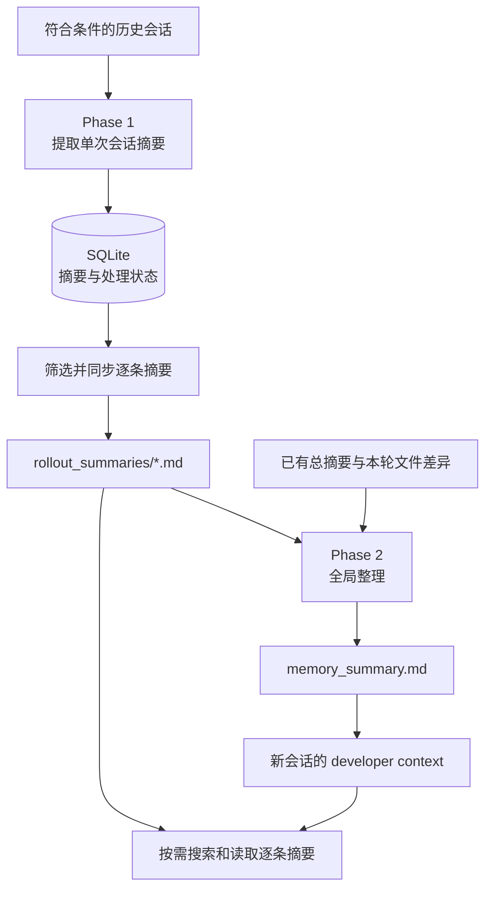
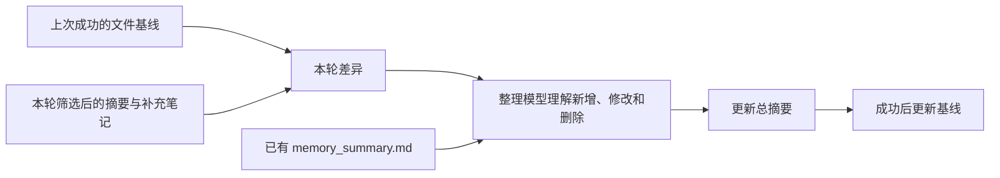

跨会话记忆需要同时保存历史和后续纠正。用户将研究范围从上下文压缩调整为持久记忆后，新会话应以最新范围开展工作，并能回溯此前的结论。

**记忆整理的目标，是把已发生的对话加工成带适用范围和来源的后续工作背景。**

Codex 的实现里，这个过程被拆成两阶段。第一阶段从单次会话提取历史，第二阶段把多份历史整理成一个较短的入口。新会话先看到入口，再按需要查阅详情。

下面重点看 Codex V2 的记忆流水线，并用提示词重放实验观察纠正如何进入记忆。源码说明运行机制，实验展示一次具体的提取与整理结果，两者的执行方式随文展开。

## 跨会话记忆处理的是更长的时间尺度

[上一篇](/posts/agent-context-management/)讨论的 checkpoint，负责当前任务跨窗口继续执行。比如：支付下单已修改，重复回调测试正在修复，下一步运行类型检查。

跨会话记忆面向后续任务。它可能记住某个项目采用的验证方式、用户明确表达的工作偏好，以及一项研究此前推进到了哪里。

同一句话，放进不同层次会产生不同影响：

| 信息 | 合适的范围 |
| --- | --- |
| 本轮先审查回调，再修改实现 | 当前任务计划 |
| 这次研究转向持久记忆机制 | 相关研究的范围与进度 |
| 用户明确要求技术说明优先使用中文 | 在表达范围内可复用的偏好 |
| 支付项目使用整数分表示金额 | 带项目范围的知识 |

所以，记忆整理除了提炼信息，还要保存适用范围。任务状态、项目事实和用户偏好，各自影响未来工作的方式不同。

## 整体结构：逐条历史加一个入口

Codex V2 的主要流程可以画成这样：[^start] [^phase1] [^phase2]



第一阶段负责把一段复杂会话加工成自包含记录。第二阶段负责让这些记录保持可导航，把重要的背景放进总摘要。

这个结构的实用之处在于：**新会话先获得一份轻量入口，历史细节仍然保留在可以继续读取的文件里。**

### V1 和 V2 保存什么

同一份源码里保留了 V1 和 V2，目录、输出契约与提示词按版本选择。这里先把它们分开：[^version] [^output]

| 项目 | V1 | V2 |
| --- | --- | --- |
| 记忆目录 | `~/.codex/memories/` | `~/.codex/memories_v2/` |
| 阶段一输出 | `raw_memory`、`rollout_summary`、`rollout_slug` | `rollout_summary`、`rollout_slug` |
| 主要阅读材料 | 总摘要、`MEMORY.md`、逐条摘要等 | 总摘要与逐条摘要 |
| 状态数据库 | `memories_1.sqlite` | `memories_v2_1.sqlite` |

这些是默认 Codex Home 下的路径；配置的 Codex Home 决定实际根目录。数据库和记忆文件目录各自有明确位置。[^sqlite]

所分析实现的版本枚举默认选择 V1，也支持配置 V2 及迁移期双写。具体机器采用哪个版本，需要结合其配置与实际文件判断。

V2 的主要阅读层可以简化为：

```text
~/.codex/memories_v2/
  memory_summary.md
  rollout_summaries/
    <会话摘要 A>.md
    <会话摘要 B>.md
  extensions/
    ad_hoc/
      instructions.md
      notes/
```

真实目录还可以包含整理过程使用的 Git 基线等辅助材料。

## 第一阶段：把一次会话写成可复用的历史

记忆流水线会在满足条件的持久根会话启动时，异步处理历史材料。功能配置、状态数据库和会话类型都参与启动判断。候选还会受到时间窗口、活跃状态和每次处理额度约束。[^start] [^phase1]

因此，某次工作刚结束后，后续整理的时机还取决于候选筛选和后台任务状态。

第一阶段读取符合条件的 rollout，将相关消息过滤、序列化后交给提取模型。V2 要求模型返回这样的结构，下面正文是解释流程的示意：

```json
{
  "rollout_summary": "用户研究了上下文压缩，随后将当前范围改为持久记忆。保留项目范围、纠正和待研究项。",
  "rollout_slug": "persistent-memory-investigation"
}
```

正式运行用严格 schema 约束字段。代码还对输出做秘密脱敏和长度处理；所分析的 V2 实现将会话摘要限制在 9,000 UTF-8 字节以内，再保存进状态数据库。[^phase1] [^output]

### 提取模型怎样理解“值得记住”

阶段一提示词把重点放在用户真实表达、任务顺序、重要纠正、已经发生的操作和仍待确认的事项。用户决定与 Agent 建议需要分开，明确观察与推测需要分开，单次要求与可复用偏好也需要分开。[^extract-prompt]

例如，用户在一项改造中要求“先给方案再编辑”，适合记录为该任务的授权顺序。若用户明确表达“以后代码改造都先给方案”，记忆才获得了更宽的适用范围。

这种范围标记看起来像文字细节，实际会影响未来 Agent 怎样行动。

阶段一还要回答结果问题：做了什么、证据在哪里、最后是什么状态。一个建议方案、一次已执行修改和一个已验证结果，应该留下不同的表述。

### 程序负责并发和重试

语义提炼交给模型，流水线协调由代码负责。

候选任务进入数据库后会被认领，并带有租约，多个后台任务由此协调处理权。成功结果写回数据库；失败结果按退避策略等待重试。[^phase1]

这层设计解决的是重复处理、并发和恢复问题。摘要内容的准确性，则还要回到提示词、输入证据和模型输出检查。

## 第二阶段：把多段历史整理成导航

逐条会话摘要积累起来后，还需要一个让新会话能够快速使用的入口。这就是 `memory_summary.md`。

阶段二先从数据库选择一批输入，依据包括保留窗口、引用次数与近期使用情况。选中的会话摘要会同步到 `rollout_summaries/`，再交给专门的整理 Agent。[^phase2] [^selection]

它还会读取本轮文件变化。Codex 在记忆目录维护一个 Git 基线，把当前输入和上次成功整理后的状态比较，生成 `phase2_workspace_diff.md`。



差异文件让整理模型看到“这次发生了什么变化”。模型再结合现有总摘要、逐条摘要和显式笔记，更新入口。

阶段二提示词要求保留有来源支持的内容，按后续纠正调整旧结论，并清理仅由已删除来源支撑的表述。V2 提示词还要求把完整总摘要控制在 10,000 UTF-8 字节以内。[^consolidation]

这里的长度单位值得留意：字节预算和 token 预算各有用途，中文字符数量还会受到 UTF-8 编码影响。

## 一条范围纠正，怎样进入记忆

提示词重放实验使用隔离记忆目录，输入来自两段已有会话中的用户表达，用于观察提取模型和整理模型如何处理范围纠正。

第一份材料来自较早的会话：用户希望结合源码理解远程压缩与本地压缩。材料还注明，研究随后转向持久记忆。

第二份材料来自后续纠正：用户进一步明确，当前希望研究 Pi memory 插件和 Codex 记忆系统怎样实现持久化。

这两份材料可以缩写为：

```text
材料 A：结合 Codex 源码解释远程压缩与本地压缩。
材料 B：当前研究聚焦 Pi memory 与 Codex 持久记忆的实现。
```

实验使用源码中的 V2 模板，通过 `codex exec` 调用模型，包括两次阶段一提取、一次初始整理和两次增量整理，共五次调用。[^lab]

### 先保存历史，再调整当前重点

第一份提取结果保留了早期压缩研究及后续方向变化。第二份提取结果则明确标记，持久记忆是当前研究范围。

增量整理后，总摘要把 Pi memory 和 Codex memory 放到了当前研究入口，压缩问题继续作为历史背景保存。

### 中间产物暴露了“偏好扩大”的问题

中间差异还暴露了范围归属问题：一次增量整理把“相关研究优先关注持久记忆”放进了 `User preferences`。

从这次用户表达能直接确定的是研究范围。若把它读成跨任务默认偏好，下一次用户明确询问压缩时，Agent 就可能继续把讨论带回 memory。

在补齐差异输入的后续整理结果里，可复用偏好被留待更多证据确认；当前研究重点放在任务背景和历史索引里。[^lab]

因此，**记忆条目需要标明适用范围：用户的通用偏好、项目约定，或单次任务的决定。**

进入总摘要的内容会影响后续会话的初始上下文。适用范围越清楚，后续 Agent 越容易在对应任务中使用它。

### 这轮实验覆盖到哪里

实验重放了源码提示词及证据整理逻辑，可以观察模型怎样提取和整合纠正。

其请求把模板嵌入 CLI 正文；Codex 原生阶段一把模板设置为 base instructions，并附严格输出 schema。原生阶段二也有专门的工具权限、租约和执行配置。[^phase1] [^lab]

因此，本文将实验结果用于分析“提示词如何处理这些证据”；后台调度和完整原生流水线的行为以源码为依据。

## 新会话怎样找到相关记忆

写入完成后，记忆还需要在合适的时机进入模型请求。

V2 读取路径先读取 `memory_summary.md`，结合读取指引生成 developer context。代码对注入文本还有 token 上限处理。新会话由此获得项目背景、用户明确偏好，以及相关历史的导航。[^read-code]

读取指引再引导模型按需查询：当某条会话的具体措辞、时间顺序、证据或不确定性可能改变当前答案时，再读取对应摘要。[^read-prompt]

```text
用户提出新任务
  -> 总摘要提供相关背景与路径
  -> 模型判断哪些细节会影响当前工作
  -> 搜索或读取对应 rollout summary
  -> 结合当前源码、配置和用户要求继续执行
```

启用专用记忆工具时，系统提供列目录、搜索和按行读取。所分析的本地搜索通过字符串匹配实现，并支持多关键词、大小写和归一化等选项。[^search]

相关性判断由总摘要、模型和检索工具共同完成。实际变化较快的事实，最后还应回到当前拥有该事实的源码或配置核实。

### 使用次数影响后续整理

Codex 还记录记忆使用信号。模型在回复中引用具体会话记忆时，会影响其 `usage_count`、`last_usage` 等元数据，后续阶段二的输入选择会用到这些字段。[^selection]

这里有两个环节：

| 环节 | 主要问题 |
| --- | --- |
| 当前任务召回 | 这次需要哪段历史，怎样找到它 |
| 后台整理选材 | 哪些历史摘要进入下一次全局整理 |

引用和近期使用为后一个环节提供信号。前一个环节仍然依赖当前问题、入口索引和模型的选择。

## 用户说“记住这件事”时发生什么

除了自动处理历史会话，读取提示词还定义了一条显式修正路径。

用户明确要求记住、忘记或纠正时，系统可以在 `extensions/ad_hoc/notes/` 追加一份小笔记，说明本次增补、删除或修正。阶段二随后结合这些材料更新总摘要。[^read-prompt] [^adhoc]

这种设计把用户意图保存成独立输入。总摘要继续由整理流程统一维护，后续差异和来源也更容易追踪。

这里的 ad-hoc note 属于跨会话记忆的修正材料；上一篇介绍的任务 Notes 则服务于同一任务的窗口交接。两者都采用笔记表达，消费者和生命周期各有分工。

数据流也要按操作看：本地文件和数据库承载记忆；提取和整理会调用配置的模型服务，输入会随请求到达相应提供方；未来会话读取的摘要与细节，也会进入该会话的模型上下文。源码中的工具权限与模型推理请求属于两个不同的执行边界。

## 记忆流水线的三个设计要点

**逐条历史与全局入口分层。** 逐条摘要保留任务细节，总摘要提供导航，新会话能够以较小的初始上下文开始工作。

**纠正携带来源与范围。** 一次范围调整、一项项目约定和一条通用偏好，进入记忆后会产生不同的影响，整理时需要保留各自的适用条件。

**语义加工与运行时协调分工。** 候选筛选、租约、失败重试、文件同步、差异输入和使用记录维护流水线的持续运行。模型负责语义加工，运行时负责组织和约束这个过程。

前面几篇讨论的机制各有分工：**压缩整理当前工作窗口，Notes 承接同一任务的进度，History 找回原始证据，长期记忆为后续任务提供有范围的背景。**

分析 Agent 的记忆行为时，需要沿着存储位置、写入主体和请求注入时机，确定相关状态所属的层次。

Codex 将会话提取和全局整理组织成两阶段后台流程。沿着这些职责继续比较，还可以看到主模型主动保存、会话结束后提炼和独立模型选择主题等组合。[下一篇](/posts/agent-memory-plugins/)从 Pi 记忆插件展开，观察这些组合怎样接进 Agent 生命周期。

---

*「Agent 上下文工程」第三篇。上一篇：[Notes、History 与任务恢复](/posts/agent-context-management/)；下一篇：[记忆插件怎样工作](/posts/agent-memory-plugins/)。*

## 参考资料与实验说明

[^start]: [记忆流水线启动条件与版本选择](https://github.com/openai/codex/blob/c419fd01a70dd1d05356da443ac44328bda2e6f4/codex-rs/memories/write/src/start.rs)。
[^phase1]: [阶段一运行时：候选处理、模型指令与严格 schema](https://github.com/openai/codex/blob/c419fd01a70dd1d05356da443ac44328bda2e6f4/codex-rs/memories/write/src/phase1.rs)。
[^phase2]: [阶段二运行时与版本化文件同步](https://github.com/openai/codex/blob/c419fd01a70dd1d05356da443ac44328bda2e6f4/codex-rs/memories/write/src/phase2.rs)。
[^version]: [MemoryVersion 与目录名称](https://github.com/openai/codex/blob/c419fd01a70dd1d05356da443ac44328bda2e6f4/codex-rs/protocol/src/memory_version.rs)。
[^output]: [V1/V2 阶段一输出契约、脱敏与长度处理](https://github.com/openai/codex/blob/c419fd01a70dd1d05356da443ac44328bda2e6f4/codex-rs/memories/write/src/phase1_output.rs)。
[^sqlite]: [状态数据库名称](https://github.com/openai/codex/blob/c419fd01a70dd1d05356da443ac44328bda2e6f4/codex-rs/state/src/sqlite.rs)。
[^extract-prompt]: [V2 阶段一提取提示词](https://github.com/openai/codex/blob/c419fd01a70dd1d05356da443ac44328bda2e6f4/codex-rs/memories/write/templates/memories/stage_one_system_v2.md)。
[^consolidation]: [V2 全局整理提示词](https://github.com/openai/codex/blob/c419fd01a70dd1d05356da443ac44328bda2e6f4/codex-rs/memories/write/templates/memories/consolidation_v2.md)。
[^selection]: [记忆引用使用记录与阶段二输入选择](https://github.com/openai/codex/blob/c419fd01a70dd1d05356da443ac44328bda2e6f4/codex-rs/state/src/runtime/memories.rs)。
[^read-code]: [总摘要读取与 developer 指令构造](https://github.com/openai/codex/blob/c419fd01a70dd1d05356da443ac44328bda2e6f4/codex-rs/ext/memories/src/prompts.rs)。
[^read-prompt]: [V2 记忆读取指引](https://github.com/openai/codex/blob/c419fd01a70dd1d05356da443ac44328bda2e6f4/codex-rs/ext/memories/templates/memories/read_path_v2.md)。
[^search]: [本地记忆搜索实现](https://github.com/openai/codex/blob/c419fd01a70dd1d05356da443ac44328bda2e6f4/codex-rs/ext/memories/src/local/search.rs)。
[^adhoc]: [显式记忆增删改的补充笔记说明](https://github.com/openai/codex/blob/c419fd01a70dd1d05356da443ac44328bda2e6f4/codex-rs/memories/write/templates/extensions/ad_hoc/instructions.md)。
[^lab]: 提示词重放实验使用隔离记忆目录，将源码中的 V2 模板放入 `codex exec` 的请求正文，共进行五次调用。比较对象包括两份输入、阶段一提取结果、中间整理差异和最终总摘要；原生流水线的指令层级、严格 schema 和后台调度另以源码为依据。
