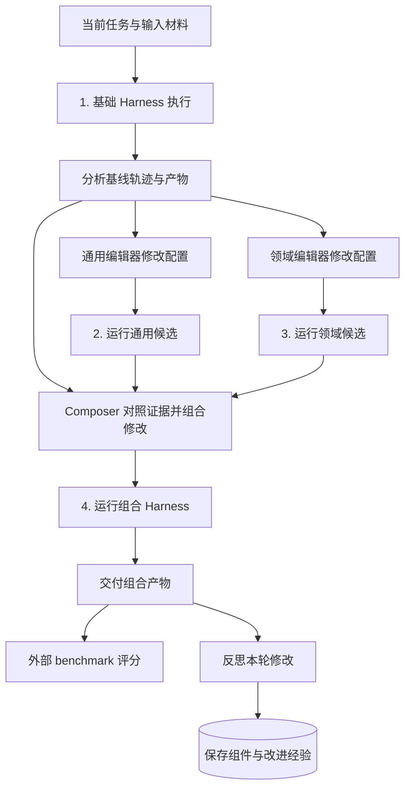
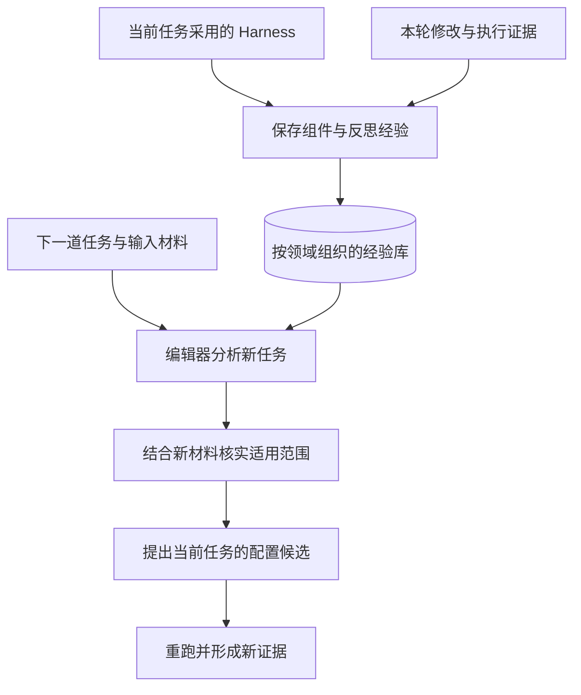

Harness² 让外层 Agent 读取执行轨迹，修改执行 Agent 的运行配置，再让它重跑同一道任务。模型参数保持冻结，修改发生在提示词、skills、工具指引和运行时插件等组件中。[^paper]

[前面的记忆文章](/posts/mem0-memory-system/)讨论经验怎样保存和进入后续模型上下文。Harness² 再往前推进一步：编辑器将执行经验转成配置修改，执行器重跑任务，用新的轨迹和产物检验修改效果。记忆复用由此接上了一条可观察的改进流程。

**完整过程是：执行基线 → 分析轨迹 → 修改配置 → 重跑比较 → 保存经验。**

在这条流程里，OpenCode 或 Codex 承担实际执行，Harness² 负责生成配置候选、对照执行证据、组合修改和保存经验。原本由工程师手动完成的调优，被组织成了一套自动流程。[^recursion][^surface]

## Harness² 改的是运行配置

Harness 是模型周围的执行系统，负责管理提示词、工具、上下文、状态和验证。[此前的 Harness Engineering 文章](/posts/harness-engineering-software-engineering/)讨论了这些组件怎样影响执行；Harness² 将组件本身开放为编辑对象。

以 OpenCode 适配为例，编辑器可以修改以下八类文件。安装器负责将文件接入执行环境。[^surface]

| 组件 | 编辑位置 | 改变什么 |
| --- | --- | --- |
| System prompt | `systemprompt.md` | 角色和总体流程 |
| Guardrails | `guardrails.md` | 检查和完成要求 |
| Memory | `LongTermMEMORY.md` | 持续进入上下文的领域知识 |
| Tool guidance | `tool_descriptions/tool_guidance.md` | 现有工具的调用方式 |
| Subagents | `sub_agents/<name>/AGENT.md` | 独立上下文里的分工 |
| Skills | `skills/<name>/SKILL.md` | 按需加载的专项流程 |
| Scripts | `scripts/<name>.py` | 经 shell 执行的确定性处理 |
| Plugins | `plugin/<name>.ts` | 工具循环里的运行时钩子 |

这里既有上下文修改，也有可执行代码修改。工具指引影响模型怎样调用已有工具，脚本增加确定性处理能力，插件则在工具循环里读取状态、注入反馈。模型权重保持冻结，调优阶段的提示词和编排程序构成固定流程。

## 一次调优怎样运行

以 `k=1` 为例，一次改进包含四次任务执行：一次基线执行、两次候选执行，以及一次组合执行。通用编辑器关注执行流程，领域编辑器关注业务规则；两者根据基线证据分别提出修改。Composer 是负责组合修改的 Agent，它对照基线和候选的轨迹、产物与文件差异，生成组合配置。[^recursion]



两次候选执行都在**同一道题**上进行。调优按设计依靠题目、输入材料、执行轨迹和产物来比较修改，外部 benchmark 评分承担最终测量。交付物来自组合版本，采用的配置与反思经验则进入经验库。[^selection][^library]

下面用渠道季度报表走一遍这条流程，观察配置修改怎样变成执行行为变化。

## 渠道报表：从错误聚合到显式计算规则

WorkBuddy Office 的 `channel-period-compare-L4-017` 要求清洗数据、比较渠道季度指标，最后交付工作簿。论文图 16 展示了这道任务的修改节选与最终结果。[^cases]


*论文图 16，展示聚合粒度、派生指标和输入处理约束。*

### 基线执行暴露聚合粒度问题

基线在错误的粒度上聚合，导致渠道行与目标键值错配，案例得分为 `23.6`。这里需要修正的是计算对象：哪些记录属于同一组，以及各项指标怎样从这一组记录中计算出来。

在调优流程里，基线轨迹和工作簿为编辑器提供参考。修改假设可以落实到具体行为：按渠道与季度聚合，并按约定口径重新计算派生指标。

### Skill 固定口径，guardrail 规定处理顺序

图中采用的 skill 写出了三项规则：

```text
聚合粒度：CHANNEL_NAME × QUARTER
佣金率：SUM(COMMISSION) / SUM(GMV)
B 端收入：PLATFORM_FEE + SERVICE_FEE
```

Skill 把分组键和计算公式显式放进执行上下文；guardrail 则补充输入只读、先清洗再聚合，以及工作表、列和交付路径要求。两类配置分别规定“算什么”和“按什么顺序处理、怎样交付”。

**这次修改把当前任务的解题口径整理成了执行流程。** 它同时携带计算规则、字段语义和交付约束，具有很强的任务针对性。源码的 `GENERALIZE` 提示词也允许将当前工作区已经核实的字段映射、单位和对应关系写进 Harness。[^prompts]

### 组合版本重跑，检查行为与产物

Composer 结合候选证据生成组合配置，执行层再用这套配置完成同一道报表任务。论文报告的最终案例分数为 `100.0`。图 16 展示采用的修改与最终结果，各候选的取舍过程可结合完整运行轨迹继续核查。

这个例子给出了明确的作用路径：**配置写明聚合粒度和公式 → 执行按这些规则处理数据 → 工作簿与任务要求更一致。** 分数描述最终交付效果，规则与行为的对应关系解释了这次修改的工程作用。

### 保存配置与经验，交给后续调优使用

按照框架的保存机制，采用的 Harness 和本轮反思会写入经验库。对于这类报表任务，可复用的内容既可能是完整 skill，也可能是“先核实聚合粒度与指标口径”这样的经验。具体保存了什么，应以该次运行的经验条目为准。[^library]

至此，当前任务形成了一条完整路径：错误聚合暴露问题，skill 和 guardrail 固定处理方式，重跑检验产物，配置与经验再进入后续任务的调优材料。

## 另外两类修改：工具协议与运行时反馈

渠道报表展示了如何整理任务口径。另外两个案例分别展示工具调用修补和状态触发反馈，修改位置与作用方式各有区别。

### 工具指引修补调用方式

WorkBuddy Code 的 `testing-hard-router_matching` 是一个路由匹配测试任务。基线把工具调用写成普通文本，回合随后结束。编辑器修改工具指引，明确要求通过原生接口发出调用。重跑后工具实际执行，测试通过，案例分数从 `60.0` 升到 `100.0`。[^cases]


*论文图 15，展示修改节选与对应执行变化。*

这次修改将“描述工具调用”转为“通过接口执行工具”。协议适配、提示词兼容性和模型对工具格式的理解，都可能影响这种行为。案例支持自动修补基础配置的价值，成熟工具配置上的边际收益适合另设对照验证。

### 插件根据运行状态注入交付提醒

JobBench 的社科研究 Agent `task3` 涉及调查数据清洗、跨来源概念对齐和研究简报生成。检索持续消耗预算，临近截止时，交付文件仍待生成。[^cases]


*论文图 19。该案例使用 Claude Opus 5 作为执行器和编辑器。*

插件用两个运行状态触发反馈：**工具调用达到 25 次，且输出目录仍为空。** 触发后，插件在工具结果末尾追加提醒，要求优先生成必要交付物。代码负责在合适的时点注入反馈，模型负责随后调整行动并生成文件。

普通提示词在任务开始时说明交付要求，插件则把“调用次数”和“目录状态”转成执行途中的反馈。这个版本还包含返回精简、可引用数据表的子代理，以及领域记忆等修改。八类组件共同变化后，案例分数从 `72.0` 升到 `100.0`。

三个案例分别改变计算口径、工具调用方式和反馈时点。它们共同展示了 Harness 调优的工程价值：**运行配置能够改变模型接下来看到的信息和执行的动作。**

## 经验怎样影响下一道任务

当前任务的交付物用于完成请求，采用的 Harness 和反思经验则用于后续调优。源码里的 improvement library 按领域保存完整 Harness、`EXPERIENCE.md` 和索引；经验条目包含触发线索、教训和证据。后续编辑器根据索引查阅相关材料，再提出新的配置修改。[^library]



经验库把前一轮的修改送入下一轮的编辑上下文。编辑器结合新任务决定采用哪些规则、核实哪些事实，再通过执行观察效果。

以渠道报表为例，可以将待复用内容分成三个层次。下表是对该案例的工程化整理，具体经验条目以运行记录为准。

| 内容 | 适用范围 | 新任务中的核实重点 |
| --- | --- | --- |
| 聚合前确认分组粒度 | 通用处理流程 | 题目要求的输出粒度 |
| 佣金率按总佣金除以总 GMV 计算 | 指标口径 | 新任务对该指标的定义 |
| `CHANNEL_NAME` 等字段与具体工作表要求 | 当前任务事实 | 新文件的字段、单位和交付约束 |

这种区分决定了经验怎样复用。通用流程可以作为检查清单，指标规则需要业务语义支持，具体字段和路径则需要回到新任务材料中核实。源码也明确要求复用历史组件时重新核实其中的事实。[^prompts]

## 成本、归因与泛化怎样评价

配置修改能够影响执行，整体收益还需要回答三个问题：提升花了多少成本，哪些修改贡献了提升，保存的经验能帮助哪些新任务。

### 提升花了多少成本

`k` 控制探索预算。并行模式同时提出多组候选，再生成多个组合版本；顺序模式则连续执行多轮改进。标准调度下，`k=1` 包含 4 次任务执行和 3 个改进阶段，`k=5` 包含 20 次执行和 15 个改进阶段，最终选择、反思和重试另计。[^recursion]

摘要中的 `11.5 / 4.5 / 11.8` 对应 `k=1` 的最高增益，分别为 WorkBuddy 平均分、JobBench 得分和 LAB Partial 百分点。它们来自各自 benchmark 上的最佳配置。例如 GLM-5 + OpenCode 在 WorkBuddy 上的结果如下。[^results]

| 配置 | 平均分 | 相对基础版本 |
| --- | ---: | ---: |
| 基础 Harness | 64.2 | 基准 |
| Harness²，`k=1` | 75.7 | +11.5 |
| Harness²，并行 `k=5` | 79.6 | +15.4 |

这组结果描述冻结模型配合整套适配流程后的交付质量。成本口径需要同时覆盖候选编辑、任务执行、组合、选择和反思。

论文图 6 将执行和改进的 token 都计入总计算量，两个 Harness² 预算设置落在作者报告的经验 Pareto 前沿上。Pareto 前沿表示所测配置中成本与表现的有效取舍：沿前沿选择更高分的配置，需要相应增加成本。该结果支持所测范围内的计算效率，更广的基础配置与预算范围仍有比较空间。[^analysis]

### 哪些修改贡献了提升

Harness² 可以理解为 LLM 引导的多变量搜索：候选受到任务、轨迹、组件范围和历史经验约束，模型采样又带来随机性。文件 diff 与轨迹提高了可观察性，因果归因则需要进一步实验。

例如交付提醒案例同时修改八类组件，最终提高 28 分。这个数字属于整套修改；插件、子代理和记忆各自的贡献，需要通过消融实验量化。消融就是有控制地移除某项修改，再比较表现变化。

| 现有材料 | 可观察的变化 | 归因所需的验证 |
| --- | --- | --- |
| 文件 diff | 配置具体改了什么 | 每项修改对应的机制假设 |
| 执行轨迹 | 工具调用和处理流程怎样变化 | 多次运行中的稳定性 |
| 最终分数 | 组合版本的交付效果 | 组件贡献及其交互效应 |
| 经验总结 | 模型怎样解释本轮收益 | 解释与后续任务结果的对应关系 |

**自动调优扩大了候选搜索范围，因果解释仍由实验支持。** 同样，反思器写下的“这个修改有用”适合作为待检验的经验假设，其可信度应随后续证据积累。

### 保存的经验能帮助哪些新任务

论文评测使用 WorkBuddy 的 100 项测试任务、JobBench 的 34 项测试任务，以及 LAB 的 100 项留出法律任务。Harness² 从空经验库开始处理测试任务流，当前题目可以重跑，前序经验可以进入后续调优。主结果报告三次打乱任务顺序的运行均值。[^bench]

这个协议评价的是**带任务时适配与经验积累的系统表现**。表 3 中，移除经验库后，WorkBuddy 和 JobBench 分别下降 `3.1` 和 `1.8` 分；跨 benchmark 的经验迁移也给出了正向结果。两类实验支持历史材料对后续任务的价值。[^analysis]

当前题目的解法整理与新任务上的经验迁移，需要分别计量。对于渠道报表，题目和输入材料中的计算规则可以支持当前任务适配；历史规则的价值则由新任务中的正确性和适用范围决定。外部答案或评分 rubric 属于评测信息，访问记录与材料隔离用于核查泄漏风险。

## 从自动调优到持续改进

论文用 RSI（Recursive Self-Improvement，递归自我改进）描述两个相连的过程：当前任务的执行证据推动配置修改，修改经验又进入后续任务的调优过程。经验库是这层递归的具体载体。[^paper]

结合机制与实验，证据可以分成三个层次：

| 层次 | 当前判断 | 依据 |
| --- | --- | --- |
| 自动完成 Harness 调优 | 工程价值明确 | 可执行修改、真实重跑、组合与经验保存 |
| 历史经验帮助新任务 | 有实验支持 | 经验库消融与跨 benchmark 迁移 |
| 改进能力随经验持续增强 | 初步证据，适合继续验证 | 固定预算下的独立任务流与长期趋势 |

第三层对应更强的持续改进要求：经验增长之后，系统以相近成本，更稳定地找到可泛化的修改。这个目标还需要处理经验库膨胀、检索成本、过期规则和领域变化。

对 Agent 工程而言，Harness² 最直接的价值，是将“配置修改 → 执行变化 → 证据保存”做成了可运行的工作链。沿着这条工作链继续落地，可以记录每项候选的机制假设，分开保存通用规则与任务事实，并在选择阶段保留基础产物作为比较项。

**持续改进的质量取决于经验怎样接受新任务检验，以及系统怎样据此保留、修订和淘汰经验。** 自动化候选生成之后，验证结果应当继续约束经验库的增长。

---

*本文基于论文 v1 与公开源码阅读，分数引用论文报告，运行复现范围另行说明。三张原图来自论文图 16、15、19，图示版权归原作者，按论文 CC BY 4.0 许可引用。*

## 参考资料

[^paper]: Google Research，[Harness²: Recursive Agent Harnessing for an Open World](https://arxiv.org/html/2610.14224v1)，arXiv `2610.14224v1`。本文采用其任务级改进与经验级递归的机制定义。

[^recursion]: 固定提交中的 [recursion.py](https://github.com/google-research/harness2/blob/1cfe254e8d25b15f37048c3730134686abe60335/harness2/core/recursion.py)，包含并行与顺序编排、候选执行及阶段调度。

[^surface]: 固定提交中的 [opencode.py](https://github.com/google-research/harness2/blob/1cfe254e8d25b15f37048c3730134686abe60335/harness2/substrate/opencode.py)，包含八类可编辑组件及其挂载方式。

[^cases]: 论文附录 E.7：[图 15](https://arxiv.org/html/2610.14224v1#A5.F15)、[图 16](https://arxiv.org/html/2610.14224v1#A5.F16)、[图 19](https://arxiv.org/html/2610.14224v1#A5.F19)。图例展示具体任务的修改节选与案例分数。

[^prompts]: 固定提交中的 [prompts.py](https://github.com/google-research/harness2/blob/1cfe254e8d25b15f37048c3730134686abe60335/harness2/core/prompts.py)，`GENERALIZE` 描述当前工作区事实回填及历史事实复核规则。

[^selection]: 固定提交中的 [selection.py](https://github.com/google-research/harness2/blob/1cfe254e8d25b15f37048c3730134686abe60335/harness2/core/selection.py)，`selection_pool()` 定义最终选择的组合产物集合。Composer 可以保持基础配置再执行一次；原始基线产物的直接回退需要单独设计，配置保持与产物回退对应两种控制能力。

[^results]: 论文[主结果表 1、表 2](https://arxiv.org/html/2610.14224v1#S3.SS2)。WorkBuddy 的并行 `k=5` 分数 `79.6` 由基础单步结果 `75.7` 加递归增益 `3.9` 得到。

[^analysis]: 论文[第 4 节](https://arxiv.org/html/2610.14224v1#S4)：图 6 为总 token 与表现对照，图 7 涉及经验库与迁移，表 3 为消融结果。

[^bench]: 论文[附录 B](https://arxiv.org/html/2610.14224v1#A2) 与公开 [Benchmark guide](https://github.com/google-research/harness2/blob/1cfe254e8d25b15f37048c3730134686abe60335/docs/BENCHMARKS.md)，说明任务划分和评测口径。

[^library]: 固定提交中的 [library.py](https://github.com/google-research/harness2/blob/1cfe254e8d25b15f37048c3730134686abe60335/harness2/core/library.py)，包含完整 Harness、经验字段和索引的保存逻辑。
