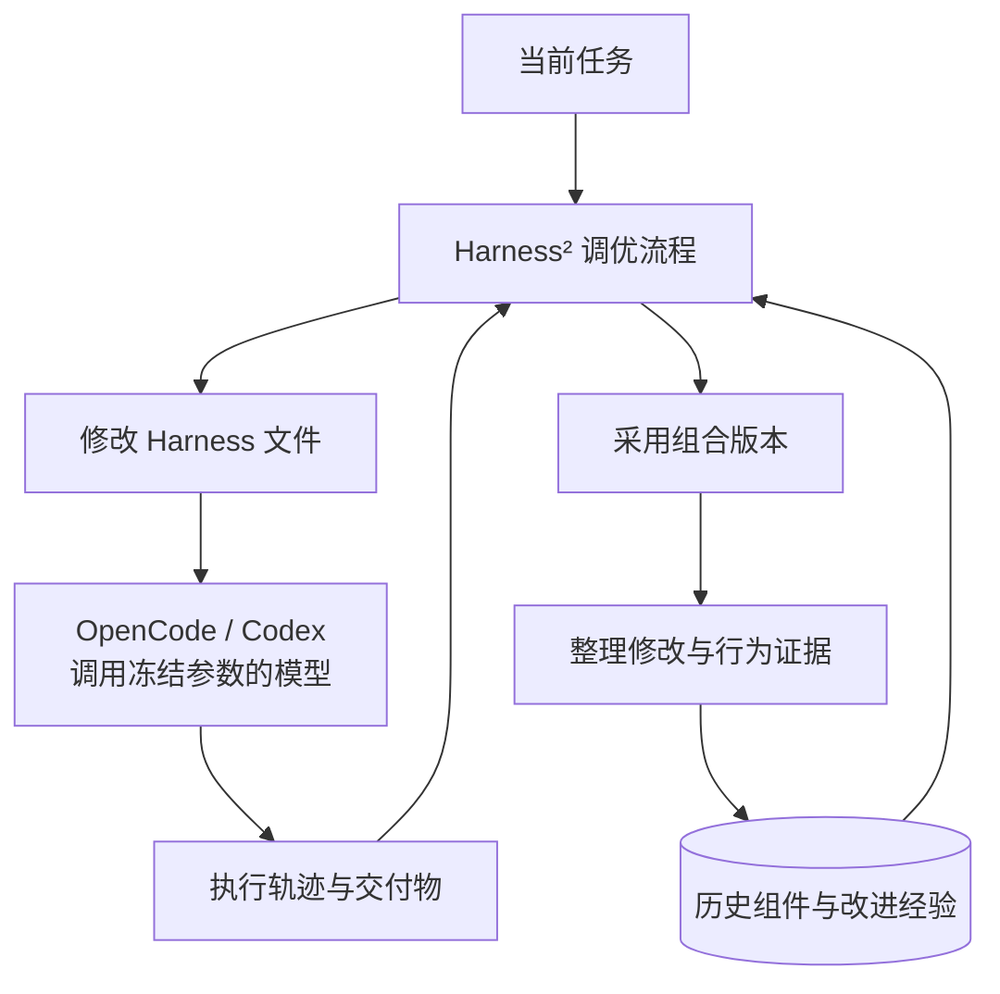
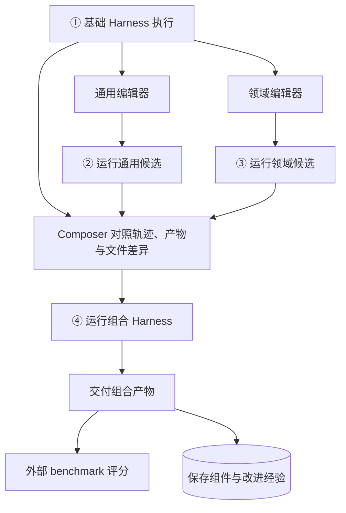

Harness² 最扎实的贡献，是把 Harness 工程里的“看轨迹、改配置、重跑、留经验”接成了一条自动流程。原来由工程师手动完成的调优，现在交给 Agent 来做，底层模型参数保持冻结。

**我的判断是：自动调优的工程价值明确，递归自我改进的证据需要分层看。**

Google Research 的这篇论文使用了 RSI（Recursive Self-Improvement，递归自我改进）来描述它：系统从当前任务的修改中积累经验，这些经验又影响后续任务的改进过程。这个定义有明确的实现对应。更进一步的判断，则取决于经验增长之后，系统能否以相近成本，更稳定地找到有效修改。[^paper]

在之前的 [Harness Engineering 文章](/posts/harness-engineering-software-engineering/)里，我把重点放在状态、工具、环境和验证怎样影响 Agent 的执行。Harness² 往前推进了一步：**把这些组件本身变成 Agent 可以修改、试跑和复用的对象。**

## 它接管了哪部分工作

做过 Agent 工程的人，对这个过程应该很熟悉：看一次失败轨迹，发现工具调用方式有问题，补一条规则；发现表格口径理解错了，写一个 skill；发现检索消耗了全部预算，就加一个交付检查。

每次修改之后再跑一次，看看结果怎样。有用的规则留下来，下一次继续用。

Harness² 把这套工作组织成了外层调优流程。OpenCode 或 Codex 承担实际执行，调优器读取任务、轨迹和交付物，修改 Harness 文件，再调用执行层重跑。[^recursion][^surface]



这张图里有两个反馈过程。当前任务的执行证据用于修改当前 Harness；保存下来的组件和经验，又会进入后续任务的调优上下文。

变化主要发生在文件和经验材料中。模型权重保持冻结，调优的阶段提示词和编排程序构成固定流程。这里的“进化”，具体表现为系统以后会读到什么经验、借用什么组件，以及据此提出什么修改。

### 改动范围覆盖八类组件

以 OpenCode 适配为例，编辑器可以修改以下文件。安装器负责将文件接入执行环境。[^surface]

| 组件 | 编辑位置 | 改变什么 |
| --- | --- | --- |
| System prompt | `systemprompt.md` | 角色和总体流程 |
| Guardrails | `guardrails.md` | 检查和完成要求 |
| Memory | `LongTermMEMORY.md` | 持续进入上下文的领域知识 |
| Tool guidance | `tool_descriptions/tool_guidance.md` | 现有工具的调用方式 |
| Subagents | `sub_agents/<name>/AGENT.md` | 独立上下文里的分工 |
| Skills | `skills/<name>/SKILL.md` | 按需加载的专项流程 |
| Scripts | `scripts/<name>.py` | 经 shell 执行的确定性处理 |
| Plugins | `plugin/<name>.ts` | 工具循环里的运行时钩子 |

所以，“改 prompt”和“改工具”都在它的操作范围里。工具指引影响模型怎样调用已有工具；脚本增加处理能力；插件可以根据运行状态，把新的反馈送入模型上下文。

这几个层次的工程意义差别很大。论文里的三个案例，刚好把它们展开了。

## 三个例子，三种收益

### 工具调用从文本变成真实执行

WorkBuddy Code 的 `testing-hard-router_matching` 是一个路由匹配测试任务。基线执行把工具调用写成普通文本，回合随后结束。编辑器修改了工具指引，明确要求通过原生接口发出调用。重跑之后，工具实际执行，测试通过，案例分数从 `60.0` 升到 `100.0`。[^cases]


*论文图 15，展示修改节选与对应执行变化。*

**这个案例首先证明了自动修补基础配置的价值。**

把工具调用打印出来就结束，属于很具体的执行缺陷。协议适配、模型对工具格式的理解和提示词兼容性，都可能影响这种行为。修掉它当然有用，也很适合交给自动调优处理。

我会继续追问成熟基础配置上的边际收益。一个把原生工具调用约定写清楚的 Harness，能够给后续比较提供更扎实的起点。这个案例本身支持的结论，落在“系统能找到并修复一处配置问题”这一层。

### 把当前题目的解法写进 skill

WorkBuddy Office 的 `channel-period-compare-L4-017` 要求清洗数据、比较渠道季度指标，最后交付工作簿。基线在错误的粒度上聚合，导致渠道行与目标键值错配。[^cases]


*论文图 16，展示聚合粒度、派生指标和输入处理约束。*

修改后的 skill 直接写出了关键计算规则：

```text
聚合粒度：CHANNEL_NAME × QUARTER
佣金率：SUM(COMMISSION) / SUM(GMV)
B 端收入：PLATFORM_FEE + SERVICE_FEE
```

Guardrails 则补充输入只读、先清洗再聚合，以及工作表、列和交付路径要求。案例分数从 `23.6` 升到 `100.0`。

看到这里，很自然会产生一个判断：**它把当前题目的解题要点写进 skill，再让执行模型做了一遍。**

这个判断抓住了案例的主要机制。这里的 skill 同时装着计算规则、字段语义和交付约束，任务专用色彩很强。源码的 `GENERALIZE` 提示词也明确允许把当前工作区已经核实的事实写进 Harness，例如字段映射、单位和对应关系。[^prompts]

评价这件事，要沿着信息来源往回看：

| 写入的内容来自哪里 | 对应的行为 | 应该验证什么 |
| --- | --- | --- |
| 题目与输入材料 | 整理当前任务的解法 | 相同预算下，分阶段求解带来多少收益 |
| 当前执行核实的事实 | 将执行证据回填到上下文 | 事实正确性和适用范围 |
| 历史任务经验 | 复用领域流程 | 新任务上的适用性 |
| 外部答案或评分 rubric | 评测信息泄漏 | 材料来源和访问记录 |

我认可把复杂任务的口径整理成显式流程。它能减少执行中的歧义，也方便检查。这个案例展示的主要是**当前任务适配**；经验迁移到新题之后的效果，需要由另一组证据承担。

### 检索占满预算时，插件提醒先交付

第三个案例是 JobBench 的社科研究助理 `task3`，工作包括清洗调查数据、对齐跨来源概念和生成研究简报。研究过程持续扩张，临近预算耗尽时，交付文件仍待生成。[^cases]


*论文图 19。该案例使用 Claude Opus 5 作为执行器和编辑器。*

它加了一个很容易理解的插件：**工具调用达到 25 次、输出目录仍为空时，在工具结果后追加提醒，要求优先生成必要交付物。**

普通 prompt 在任务开始时说“注意完成交付”；这个插件则读取运行状态，在执行已经偏向持续检索时，再把交付要求送进下一轮上下文。

两者的差别在触发条件。插件用“调用次数”和“目录是否为空”识别具体状态，模型随后决定怎样调整行动。提醒的注入由代码负责，文件生成由模型完成。

这个版本还增加了返回精简、可引用数据表的子代理，以及调查总体、权重和概念对应等领域记忆。图中八类组件均有修改，最终案例分数从 `72.0` 升到 `100.0`。这 28 分属于整套改动，插件的独立贡献仍待组件消融来量化。

三个案例放在一起，实际收益就清楚了：协议修补解决执行缺陷，skill 整理解题口径，插件把运行状态转成及时反馈。**这些都是具体的 Agent 工程工作，Harness² 把提出和尝试这些改动的过程自动化了。**

## 分数背后跑了多少次

以 `k=1` 为例，一次改进包含四次任务执行：基线、两个候选、一个组合版本。两个编辑器分别关注通用执行流程和领域问题，Composer 对照执行证据后组合改动。[^recursion]



两个候选都在**同一道题**上重跑。调优按设计依靠题目、输入材料、执行轨迹和产物来判断，外部 benchmark 评分承担最终测量。这也是它面向开放任务的设计出发点：调优过程使用执行证据和模型判断来比较候选。

`k` 控制探索预算。并行模式同时提出多组候选，再生成多个组合版本；顺序模式则连续执行多轮改进。标准调度下，`k=1` 是 4 次任务执行和 3 个改进阶段，`k=5` 是 20 次执行和 15 个改进阶段，最终选择、反思和重试另计。

这里还有一个实现细节：固定提交中的最终选择池收集组合版本的产物。Composer 可以保持基础配置再执行一次；原始基线产物的直接回退，则需要单独设计。配置保持和产物回退，分别对应两种控制能力。[^selection]

### 最高增益属于哪一组

摘要里的 `11.5 / 4.5 / 11.8` 是单步改进，也就是 `k=1` 的最高增益，分别对应 WorkBuddy 平均分、JobBench 得分和 LAB Partial 百分点。它们来自各自 benchmark 上的最佳配置。[^results]

拿 GLM-5 + OpenCode 在 WorkBuddy 上的结果来看：

| 配置 | 平均分 | 相对基础版本 |
| --- | ---: | ---: |
| 基础 Harness | 64.2 | 基准 |
| Harness²，`k=1` | 75.7 | +11.5 |
| Harness²，并行 `k=5` | 79.6 | +15.4 |

这些结果测的是冻结模型配合整套适配流程之后的交付质量。基础配置执行一次，与调优流程执行多次，各自消耗的总预算需要一起进入比较。

论文也做了这个比较。图 6 把执行和改进的 token 都计入总计算量；在作者测量的配置里，Harness² 的两个预算设置落在经验 Pareto 前沿上。也就是在这些实验点之间，同时考虑得分和总 token，它们处于有竞争力的位置。这个结果支持所测范围内的计算效率，更广的基础配置和预算范围仍值得继续比较。[^analysis]

### 测试集上做的是任务时适配

论文评测使用 WorkBuddy 的 100 项测试任务、JobBench 的 34 项测试任务，以及 LAB 的 100 项 held-out 法律任务。Harness² 从空经验库开始处理测试任务流，前序任务积累的经验可用于后续任务。主结果报告三次打乱任务顺序的运行均值。[^bench]

所以读这些分数时，要同时记住两个条件：当前题目可以重跑，前面题目的经验可以留下来。它评价的是**带任务时适配与经验积累的系统表现**。

这个设定很贴近持续工作的 Agent。对应的评测责任也更具体：固定任务划分，隔离评分材料，记录网络访问，并统计执行器和改进器的总成本。这样才能看清分数来自哪些能力。

## “让 AI 炼丹”的质疑，落在归因上

手工调 Harness，本来就常常是在组合 prompt、skills、工具和 hooks，再通过运行结果判断效果。Harness² 把候选生成交给模型之后，搜索速度和搜索范围都可以扩大。

更准确的描述是 **LLM 引导的多变量搜索**。候选受到当前任务、执行轨迹、组件范围和历史经验的约束，模型采样又带来随机性。

文件化修改和完整轨迹提高了可观察性：改了哪些文件、工具调用怎样变化、最后生成了什么，都有材料可查。

**因果归因则是另一项工作。** 一次改八类组件，得分涨了 28 分，能说明组合版本在该次运行中表现更好。要知道哪一项贡献最大、哪些修改互相依赖、随机波动占多少，就需要重复试验和消融。

| 现有材料 | 能直接看到什么 | 进一步归因需要什么 |
| --- | --- | --- |
| 文件 diff | 配置发生的变化 | 每项变化对应的机制假设 |
| 执行轨迹 | 行为发生的变化 | 多次运行中的稳定性 |
| 最终分数 | 组合版本的交付效果 | 组件消融和交互效应比较 |
| 经验总结 | 模型给出的解释 | 独立任务上的验证 |

尤其是经验库。Reflector 写下“这个修改有用”，这是一条值得测试的假设。反思文字的可信度，要靠后续任务中的行为证据逐步建立。

我的担心主要落在这里：**调优可以自动化，因果解释仍需要实验。** 当系统越来越擅长生成候选，验证和归因会成为更紧的约束。

## RSI 的证据分三层

论文已经给出了一些值得认真看的结果。表 3 中，移除经验库后，WorkBuddy 和 JobBench 分别下降 `3.1` 和 `1.8` 分；作者还展示了跨 benchmark 的经验迁移。它们支持“保存下来的材料能帮助后续任务”这个判断。[^analysis]

源码里的 improvement library 按领域保存完整 Harness、`EXPERIENCE.md` 和索引，经验包含触发线索、教训和证据。后续编辑器可以查阅这些材料，调整自己的候选。这就是论文所说的 harnessing-level recursion 的具体载体。[^library]

我会把当前证据放在三个层次里看：

| 层次 | 当前判断 | 证据 |
| --- | --- | --- |
| 自动完成 Harness 调优 | 工程价值明确 | 可执行修改、真实重跑、组合与经验保存 |
| 历史经验帮助新任务 | 有实验支持 | Library 消融和跨 benchmark 迁移 |
| 改进能力随经验持续增强 | 初步证据，值得继续验证 | 需要固定预算下的独立任务流和长期趋势 |

第三层是我对更强 RSI 结论的要求：经验越来越多之后，系统应当用相近成本，更稳定地找到可泛化的修改。这个比较还要处理经验库膨胀、检索成本、过期规则和领域变化。

这也给工程落地提供了一个明确方向：把每次修改的来源、适用范围和后续表现记录下来，让经验保留逐渐受到实际结果约束。

## 调优自动化之后，验证要跟上

如果借鉴 Harness² 来做自己的 Agent，我会优先保留三件东西：可执行的配置修改、可对照的运行材料，以及带证据的经验库。

然后把验证做细一点：

- 每个候选标明改了哪个组件、预期改变什么行为，方便后续归因。
- 将通用流程、领域规则和当前任务事实分别标注，复用时核实适用范围。
- 在选择阶段保留基础产物作为比较项，同时统计编辑、执行、组合和反思的总成本。
- 让值得保留的修改继续接受新任务检验，经验库按实际效果积累可信度。

Harness² 把一项熟悉的工程工作变成了可以研究、测量和扩展的流程，这件事本身就有价值。它最有说服力的结果，是自动修改确实带来了行为变化，经验材料也确实影响了后续表现。

**我更看重的下一步，是自动验证和经验淘汰。** 候选可以批量生成，经验库也可以持续增长；决定这套系统长期质量的，会是哪些经验经得起新任务检验，以及系统怎样根据结果更新自己的判断。

---

*本文基于论文 v1 与公开源码阅读，分数沿用作者报告，运行复现属于后续验证范围。源码固定到 `1cfe254e8d25b15f37048c3730134686abe60335`。三张原图来自论文图 15、16、19，图示版权归原作者，按论文 CC BY 4.0 许可引用。*

## 参考资料

[^paper]: Google Research，[Harness²: Recursive Agent Harnessing for an Open World](https://arxiv.org/html/2610.14224v1)，arXiv `2610.14224v1`。本文采用其任务级改进与经验级递归的机制定义。

[^recursion]: 固定提交中的 [recursion.py](https://github.com/google-research/harness2/blob/1cfe254e8d25b15f37048c3730134686abe60335/harness2/core/recursion.py)，包含并行与顺序编排、候选执行及阶段调度。

[^surface]: 固定提交中的 [opencode.py](https://github.com/google-research/harness2/blob/1cfe254e8d25b15f37048c3730134686abe60335/harness2/substrate/opencode.py)，包含八类可编辑组件及其挂载方式。

[^cases]: 论文附录 E.7：[图 15](https://arxiv.org/html/2610.14224v1#A5.F15)、[图 16](https://arxiv.org/html/2610.14224v1#A5.F16)、[图 19](https://arxiv.org/html/2610.14224v1#A5.F19)。图例展示具体任务的修改节选与案例分数。

[^prompts]: 固定提交中的 [prompts.py](https://github.com/google-research/harness2/blob/1cfe254e8d25b15f37048c3730134686abe60335/harness2/core/prompts.py)，`GENERALIZE` 描述当前工作区事实回填及历史事实复核规则。

[^selection]: 固定提交中的 [selection.py](https://github.com/google-research/harness2/blob/1cfe254e8d25b15f37048c3730134686abe60335/harness2/core/selection.py)，`selection_pool()` 定义最终选择的组合产物集合。

[^results]: 论文[主结果表 1、表 2](https://arxiv.org/html/2610.14224v1#S3.SS2)。WorkBuddy 的并行 `k=5` 分数 `79.6` 由基础单步结果 `75.7` 加递归增益 `3.9` 得到。

[^analysis]: 论文[第 4 节](https://arxiv.org/html/2610.14224v1#S4)：图 6 为总 token 与表现对照，图 7 涉及经验库与迁移，表 3 为消融结果。

[^bench]: 论文[附录 B](https://arxiv.org/html/2610.14224v1#A2) 与公开 [Benchmark guide](https://github.com/google-research/harness2/blob/1cfe254e8d25b15f37048c3730134686abe60335/docs/BENCHMARKS.md)，说明任务划分和评测口径。

[^library]: 固定提交中的 [library.py](https://github.com/google-research/harness2/blob/1cfe254e8d25b15f37048c3730134686abe60335/harness2/core/library.py)，包含完整 Harness、经验字段和索引的保存逻辑。
