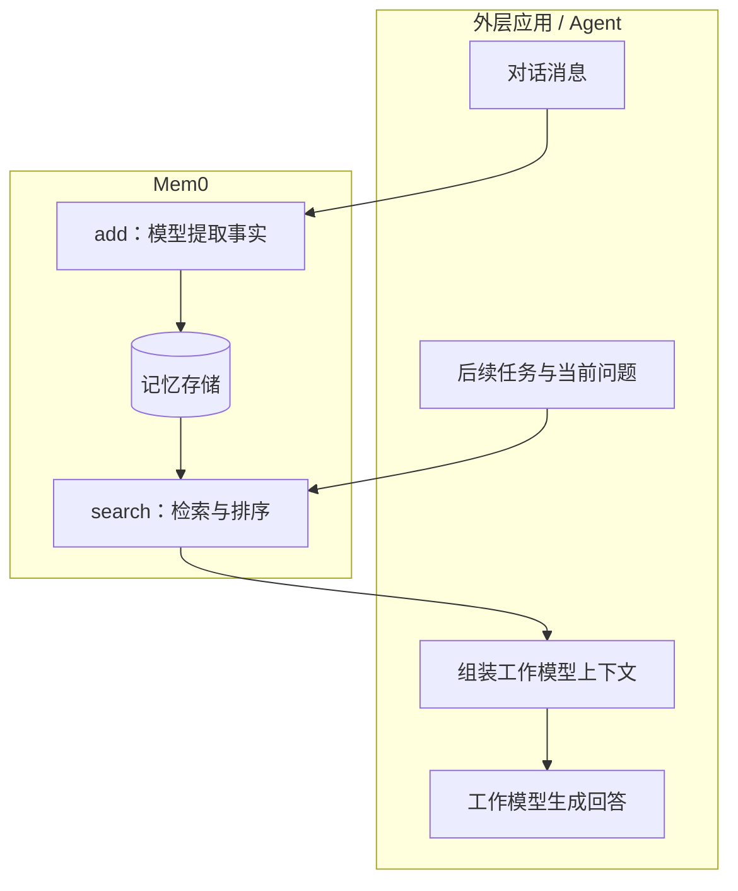
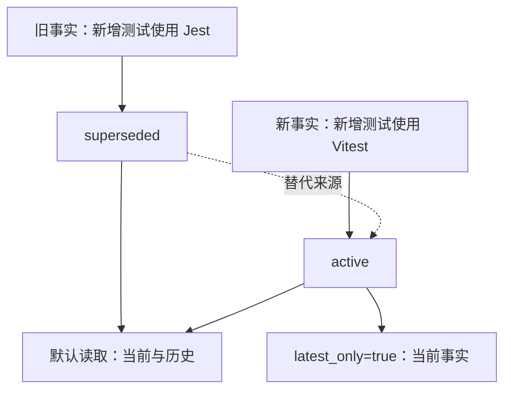

支付项目以前用 Jest，用户后来明确要求：“后续新增测试统一使用 Vitest，历史测试逐步迁移。”一个月后，Agent 接到新增回调用例的任务。它需要取回当前约定，同时保留“仓库仍有历史 Jest 用例”这个背景。

这条链里有两个独立问题：新对话怎样变成记忆，后续任务怎样选出适用的事实。[上一篇](/posts/agent-memory-plugins/)讨论的插件，把这些环节接进 Agent 生命周期。Mem0 将提取、存储和检索组织成可单独调用的记忆层。

**Mem0 用模型把对话加工成事实，用检索把相关事实送回应用；事实何时进入工作模型的上下文，由外层 Agent 或产品集成决定。**

下面先沿 Python OSS V3 的源码走一遍，再讨论托管 Platform 的 Dream。两种部署形态各有维护能力，早期论文又采用另一代写入算法。源码链接指向所分析的固定版本，数据与请求片段均为机制示意。

## “应用”是谁，Mem0 负责什么

应用是接入 Mem0 的调用方，例如聊天产品后端、Pi 扩展、Agent harness，或把 Mem0 封装成工具的 MCP 服务。它掌握当前用户、任务和对话生命周期，可以决定一次回答完成后保存哪些消息，以及下一次回答前用什么问题搜索。

典型调用可以画成两条路径：



两条路径可以在相隔很久的任务里执行，也可以由插件在每轮对话中衔接。Mem0 MCP 则允许主模型通过工具调用参与存取判断。[^overview]

这里的 AI 分为工作模型、记忆提取模型和 embedding 模型几种职责，部署时可以配置相应组件。工作模型完成回调测试，提取模型生成可复用事实，embedding 模型将查询和事实编码为向量，供相似检索使用。可选 reranker 再对结果排序。[^config]

## add 的输入与产物

下面的 Python 示例展示 OSS 调用形状，假定 `memory` 已完成模型和存储配置。内容为机制示意：

```python
memory.add(
    [
        {
            "role": "user",
            "content": "支付项目后续新增测试统一使用 Vitest，历史 Jest 用例逐步迁移。"
        }
    ],
    user_id="developer-17",
    agent_id="coding-agent",
    metadata={"project": "payments", "source_task": "task-a"}
)
```

`user_id` 表示用户范围，`agent_id` 表示 Agent 范围。这个案例让旧 Jest 记录和新 Vitest 记录共享稳定的 user、agent 身份，把项目和任务来源放进 metadata，供业务层分类、追溯和查询过滤。

**`run_id` 会同时收窄写入参考与读取范围。** 若添加 `run_id="task-a"`，写入阶段检索的旧事实会限定在这个 run；后续搜索过滤 `run_id="task-b"`，候选也会限定在 `task-b`。本例采用跨任务共享的身份范围，任务来源通过 `source_task` 保存，后续请求沿同一身份范围召回。[^main]

项目范围还需要单独落实：当前 `add` 的旧记忆查询使用 user、agent、run 身份字段，metadata 中的 `project` 用于后续搜索过滤。若业务要求写入阶段也按项目严格隔离，可以按项目划分 Agent 身份或记忆实例。调用者负责给这些 ID 建立稳定、可信的映射。

在默认 `infer=True` 路径里，Mem0 先补充上下文，再调用提取模型。所分析的 `_add_to_vector_store` 执行顺序为：[^main]

1. 根据 user、agent、run 组合构建 scope，从 SQLite 读取最近 10 条消息。
2. 将当前消息编码成向量，在相应身份范围内取 top-10 旧记忆。
3. 调用一次 LLM，返回事实列表。
4. 批量生成事实 embedding，在召回旧记忆和本批次范围内检查文本 hash。
5. 写入向量存储，记录变更历史，并提取实体建立搜索关联。
6. 保存当前消息，作为后续提取的近期上下文。

SQLite 中的近期消息帮助解释“这个项目”“改成它”等指代，长期事实则通过记忆集合检索。`save_messages` 也会按 scope 清理旧消息，保留最近 10 条，因此这张消息表承担短期提取上下文的职责。[^storage]

### 提示词究竟要求模型做什么

V3 的 `ADDITIVE_EXTRACTION_PROMPT` 要求模型从新消息中提取自包含事实，同时区分用户表达与 Agent 提供的信息。已有记忆用于去重与关联，历史消息提供指代背景。[^prompt]

当前主 `add` 路径将旧记忆、新消息、最近消息及自定义指令交给提取模型。对于这次纠正，命中的旧 Jest 记录提供背景，新消息给出 Vitest 约定与历史用例的迁移范围。

示意输出可以缩写为：

```json
{
  "memory": [
    {
      "id": "0",
      "text": "支付项目后续新增测试使用 Vitest，历史 Jest 用例逐步迁移。",
      "attributed_to": "user"
    }
  ]
}
```

真实输出的拆分方式、措辞和语言取决于提取模型及指令。这里展示的是数据形状。条目 `id` 是本次提取列表中的序号，存储时程序另行分配 UUID。

<details>
<summary>源码补充：提示词字段怎样进入持久状态</summary>

user prompt builder 预留 Summary、Last k Messages、Recently Extracted Memories、Existing Memories、New Messages 和日期等区块。当前主 `add` 路径实际填入旧记忆、新消息、最近消息及自定义指令。模板栏位和调用时填入的内容各有范围。

提取模板还允许模型返回 `linked_memory_ids`，表达新事实与旧记忆的关系。当前 Python 实现将 top-10 旧 UUID 映射为短序号交给模型；持久化循环随后读取 `text` 与 `attributed_to`，构建事实 payload。模型输出的关联字段停留在提取结果层。[^main] [^prompt]

实体集合也使用 `linked_memory_ids` 这个字段，但它保存的是“某实体关联哪些记忆 UUID”，由程序在实体提取后建立。

这两个位置需要分开：

| 位置 | 关联的含义 | 所分析路径中的用途 |
| --- | --- | --- |
| 提取模型输出 | 新事实与旧事实相关 | 模板输出字段 |
| 实体集合 payload | 某实体出现在一组事实中 | 搜索时计算实体加分 |

**源码里的字段经过消费和持久化，才会成为下一次检索可使用的状态。** 核查记忆机制时，输入提示词、模型 JSON、写入 payload 和搜索读取路径应当连起来看。

</details>

## 记忆具体存在哪里

OSS 的向量存储承载 embedding、事实文本和 metadata。一个简化的逻辑记录如下，UUID 和时间均为示意：

```json
{
  "id": "memory-v2",
  "data": "支付项目后续新增测试使用 Vitest，历史 Jest 用例逐步迁移。",
  "user_id": "developer-17",
  "agent_id": "coding-agent",
  "project": "payments",
  "source_task": "task-a",
  "attributed_to": "user",
  "created_at": "2026-10-25T07:00:00+00:00"
}
```

实际 payload 还包括 hash、更新日期、用于关键词搜索的文本等字段；embedding 与记录 ID 一起写入配置的向量库。SQLite 默认使用 `~/.mem0/history.db`，记录变更历史和消息。实体集合通常使用 `{collection}_entities` 名称，部分存储 provider 有命名适配。[^main] [^config] [^storage]

所以 Mem0 OSS 的主要存储形态是数据库记录。使用自托管环境时，LLM 和 embedding 的实际请求去向仍取决于配置，读取后进入工作模型的正文也随该模型请求流动。

## 遇到冲突时，先看算法版本

Mem0 的早期论文描述两次模型调用：先提取候选事实，再检索旧记忆，让更新步骤决定 ADD、UPDATE、DELETE 或 NOOP。当前 OSS V3 将常规提取改为单次 LLM 调用，自动写入采用 ADD-only。[^paper] [^migration]

这意味着“Mem0 自动维护记忆”需要同时注明所指的版本和部署方式。

### OSS V3：新事实追加，当前状态由应用维护

已有事实是“支付项目新增测试使用 Jest”，新消息改成 Vitest。OSS 自动提取会把新的约定写成事实，旧条目继续保存。

下面把这条记忆走到下一次行动。**全表为机制示意**：假设模型成功提取新事实，旧、新两条记录均进入后续搜索结果，应用保留来源顺序，并采用“范围相同的明确纠正优先”策略。

| 环节 | 记录、请求与行动 |
| --- | --- |
| 旧记录 | `memory-v1`，来源 `task-before`：<br>支付项目新增测试使用 Jest。 |
| 新输入 | `task-a` 明确纠正：<br>后续新增测试统一使用 Vitest；<br>历史 Jest 用例逐步迁移。 |
| 写入后 | 保留 `memory-v1`；追加 `memory-v2`：<br>新增测试用 Vitest；<br>历史 Jest 用例逐步迁移。 |
| 召回 | `task-b` 要新增回调测试。<br>按同一用户、Agent、项目检索，<br>返回 `memory-v1` 与 `memory-v2`。 |
| 组装请求 | 应用采用 `task-a` 的明确纠正，<br>将 Vitest 作为当前约定；<br>将旧 Jest 记录作为历史背景。 |
| 最终行动 | Agent 结合当前配置，<br>为新增用例采用 Vitest。 |

这里的来源顺序与选择策略由应用维护。`created_at` 记录入库时间，事实的生效时间和“这是一次纠正”的含义可以由应用另行记录。表中展示的是这一策略成立时的连续产物，真实命中、排名和最终行动应通过实际请求另行验收。[^main]

程序的 hash 去重只比较召回的旧条目与本批次的相同文本。语义重复主要依赖模型看到的 top-10 去重上下文；写法变化、候选遗漏和 scope 选择，都可能让近义条目继续积累。[^main]

冲突处理可以由应用明确执行：找到旧 UUID，调用 `update` 更新条目；或者维护 effective date、适用模块和来源记录，再按业务策略读取。对需要保留历史的场景，新旧事实并存有助于回答迁移过程中的问题。

这里还要区分**相关性**和**当前有效性**。搜索分数回答“这条记忆与问题有多相关”；“后续新增测试该采用哪个框架”还需要变更时间、适用范围和用户明确决定。

### Platform Dream：标记替代关系，保留历史

托管 Platform 的 Dream 提供三种维护动作：Supersede 标记被新事实取代的旧记忆，Merge 将重复内容归到 canonical 记忆，Synthesis 从多条事实生成带来源的高层模式。前两项随添加流程执行，Synthesis 采用可选后台调度。[^dream]

对于 Jest → Vitest，状态演进可以这样表示：



这是一张语义示意图。Dream 默认读取包含 active 与 superseded，Merge 后的重复项默认隐藏、记录继续保留。`latest_only=true` 筛选当前事实；`include_merged=true` 扩大历史可见范围。

这些状态和读取行为来自 Platform 公开文档。托管服务内部采用的具体提示词、候选选择和判断阈值，以公开接口能建立的证据范围为准。OSS 的 `update` 与 Platform 的 supersede 状态分别属于各自维护路径。

## 跨任务召回，先确定搜索范围

前面的记忆由 `task-a` 写入。现在 `task-b` 要增加支付回调用例，外层应用可以这样搜索：

```python
result = memory.search(
    "支付项目后续新增回调测试采用什么框架？",
    filters={
        "user_id": "developer-17",
        "agent_id": "coding-agent",
        "project": "payments"
    },
    top_k=5,
    explain=True
)
```

搜索保留与写入相同的用户、Agent 身份，再以 `project="payments"` 筛选项目材料。这样 `task-before` 的 Jest 记录与 `task-a` 的 Vitest 记录都可以进入候选。追溯某次任务时，则可增加 `source_task` 过滤条件。[^main]

**跨任务召回靠稳定身份与查询范围贯通。** 长对话持续进入 `add` 后，未来查询面对的是积累下来的事实集合，而逐字对话追溯应由原始日志或 History 另行提供。

用户空间还需要应用鉴权来约束：可信服务从登录身份取得 `user_id`，再组装过滤条件。ID 负责数据分组，访问授权由接入产品维护。

### search 怎样选择候选和排序

搜索路径依次执行：

```text
问题 → 词形处理、实体提取和查询 embedding
     → 按 filters 取语义候选
     → 获取关键词分数与实体关联加分
     → 按语义分数过滤阈值，再融合排序、选取 top-k
     → 按配置执行可选 reranker
```

BM25 强化专有名词和关键词匹配，实体信号强化同一项目或对象的关联。当前实现以语义结果形成候选集，关键词和实体信号在这个集合内影响排序。因此，候选覆盖与候选排序需要分别验收。[^migration] [^ranking]

对 Jest → Vitest 这个案例，先检查两条事实是否进入候选，再检查返回正文是否保留“后续新增”与“历史迁移”的范围。两条事实的分数决定相关性排序，当前约定继续由前面的应用策略选择。

<details>
<summary>检索补充：候选预算、阈值与分数解释</summary>

当前 Python OSS 默认 `top_k=20`、`threshold=0.1`、`rerank=False`。`_search_vector_store` 的内部语义候选数采用 `max(top_k × 4, 60)`；例如上面的 top-5 查询，初始语义候选预算是 60。[^main]

`threshold` 在融合前检查语义分数，最终 `score` 则是融合后的数值。排查某条记忆为什么被筛掉时，先确认它是否进入语义候选、语义分数是否达到门槛，再查看其他信号的排序贡献。

`explain=True` 可以返回分数细节，便于检查当前依赖组合下哪些信号参与了排序。NLP 模型、向量库关键词能力和 reranker 配置都会影响实际路径，中文与中英混合项目名适合加入本地样本。

</details>

<details>
<summary>检索补充：实体关联与事件时间</summary>

OSS V3 的实体集合将实体文本与记忆 UUID 关联起来。Platform 的 Graph Memory 也通过共享人物、项目或概念连接事实，并将匹配结果用于搜索加权。早期论文 `Mem0ᵍ` 使用带关系类型的实体三元组，图语义应按各代实现阅读。[^graph] [^paper]

Platform 的 Temporal Reasoning 则将查询里的时间意图与事实事件日期匹配。“迁移前用什么”与“当前新增测试用什么”对应两个读取目标。记录入库时间、事实发生时间和生效范围，各自承载一类信息。[^temporal]

实体关联帮助找同一对象的材料，时间信号帮助缩小时间范围，冲突状态帮助表达事实演进。它们组合起来才更接近“找到当前问题需要的那段背景”。

</details>

## 结果怎样影响工作模型

`search` 返回事实与分数，应用还需要组装模型请求。例如，将记忆来源和适用范围保留在一个单独区块中：

```text
相关历史背景：
- 来源：用户在 task-a 中明确调整的项目约定。
- 范围：payments 后续新增测试。
- 内容：新增测试使用 Vitest，历史 Jest 用例逐步迁移。

当前任务：
为支付回调增加幂等性测试。
```

这是请求内容示意，消息角色和注入位置由具体 harness 决定。模型随后结合当前代码、测试配置和用户本轮要求执行。

记忆在这里承担导航和背景作用：它解释迁移决定和用户意图，当前仓库负责给出实际可执行的工具链。验收时应观察最终请求、采用的记忆条目和实际测试命令，才能确认召回如何影响行动。

## 记忆系统的分工怎样选择

沿着前几篇可以看到三种组织方式：Codex 从会话历史整理出入口，Pi 插件把保存和读取接进宿主生命周期，Mem0 把事实加工与检索提供为独立接口。

对已有 `AGENTS.md`、Notes 和 History 的 coding agent，适合先确定长期记忆的增量职责：用户协作偏好、项目决定背后的原因，以及未来任务仍需理解的范围。对服务多用户的 Agent 或长期运行的机器人，身份隔离、事件时间和事实演进会成为更持续的工作。

系统选择可以从同一个小实验开始：保存 Jest 约定，给出带范围的 Vitest 纠正，再从新任务分别问“当前新增测试用什么”和“之前为什么迁移”。检查存储条目、搜索过滤条件、返回状态和最终模型请求，评估当前事实与历史解释能否各得其所。

**一份可用的记忆，需要在新任务里被正确选中，并保持来源、范围和时间的含义。** 记忆服务提供加工与检索，外层应用负责将这些材料接入工作流，当前执行再产生新的验证证据。

再往前一步，经验还可以推动提示词、工具指引和运行时配置发生变化。[Harness²](/posts/harness2-agent-harness-optimization/)把这条路径组织成“分析轨迹 → 修改配置 → 重跑验证 → 保存经验”的工作链，接着讨论经验怎样接受后续任务检验。

---

*「Agent 上下文工程」第五篇。上一篇：[记忆插件怎样工作](/posts/agent-memory-plugins/)；延伸阅读：[Harness²：Agent 开始自己调 Harness 了](/posts/harness2-agent-harness-optimization/)。*

## 源码与证据范围

本文依据 Python OSS 源码与 Platform 官方文档说明机制，源码链接指向所分析的固定版本。V3 指官方迁移指南所称的新算法；Platform 与早期论文分别按各自接口和流程讨论。

数据、连续对照表与请求片段均为机制示意。闭环中的事实提取、两条记忆同时命中、应用策略和最终行动属于明确列出的案例前提；真实模型的提取质量、冲突处理和跨任务召回效果，适合结合实际模型与存储配置复测。

[^overview]: [Mem0 工作原理](https://docs.mem0.ai/core-concepts/how-it-works)与 [Quickstart](https://docs.mem0.ai/platform/quickstart)。
[^config]: [MemoryConfig 与记录字段](https://github.com/mem0ai/mem0/blob/2c81af3bbe27d9bccb09c772d583df9e9be72ee5/mem0/configs/base.py)。
[^main]: [Memory.add、_add_to_vector_store、search 与 _search_vector_store](https://github.com/mem0ai/mem0/blob/2c81af3bbe27d9bccb09c772d583df9e9be72ee5/mem0/memory/main.py)。
[^storage]: [SQLite 历史与消息读写](https://github.com/mem0ai/mem0/blob/2c81af3bbe27d9bccb09c772d583df9e9be72ee5/mem0/memory/storage.py)。
[^prompt]: [ADDITIVE_EXTRACTION_PROMPT 与 prompt builder](https://github.com/mem0ai/mem0/blob/2c81af3bbe27d9bccb09c772d583df9e9be72ee5/mem0/configs/prompts.py)。
[^paper]: [Mem0: Building Production-Ready AI Agents with Scalable Long-Term Memory](https://arxiv.org/html/2504.19413)，2025 年论文中的提取、更新和图记忆流程。
[^migration]: [OSS 新算法迁移说明](https://docs.mem0.ai/migration/oss-v2-to-v3)。
[^dream]: [Platform Dream：Supersede、Merge 与 Synthesis](https://docs.mem0.ai/platform/features/dream)。
[^ranking]: [多信号融合排序实现](https://github.com/mem0ai/mem0/blob/2c81af3bbe27d9bccb09c772d583df9e9be72ee5/mem0/utils/scoring.py)。
[^graph]: [Platform Graph Memory](https://docs.mem0.ai/platform/features/graph-memory)。
[^temporal]: [Platform Temporal Reasoning](https://docs.mem0.ai/platform/features/temporal-reasoning)。
